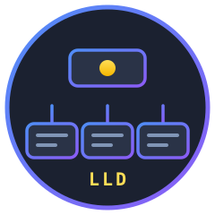

<a name="readme-top"></a>

[![Contributors][contributors-shield]][contributors-url]
[![Forks][forks-shield]][forks-url]
[![Stargazers][stars-shield]][stars-url]
[![Issues][issues-shield]][issues-url]
[![MIT License][license-shield]][license-url]
[![Website][website-shield]][website-url]

<div align="center">
  <a href="https://github.com/abhaypaswan/lld-python">
    
  </a>

  <h3 align="center">Low Level Design in Python</h3>

  <p align="center">
    Working implementations of the design problems that actually get asked in machine coding rounds
    <br />
    <a href="https://goatengineer.com"><strong>Practise these on GOAT Engineer »</strong></a>
    <br />
    <br />
    <a href="https://github.com/abhaypaswan/lld-python/issues">Report a bug</a>
    ·
    <a href="https://github.com/abhaypaswan/lld-python/issues">Request a problem</a>
  </p>
</div>

## About

Low-level design is badly served by the internet. DSA has structured practice —
graded problems, a judge that tells you whether you were right. LLD has blog
posts with a class diagram, no code, and no way to tell whether the design
actually holds up.

This repository is the other thing: every problem here has a **working
implementation you can run**, a **test suite that pins down the behaviour that
matters**, and a write-up explaining why the design is shaped the way it is —
including the bugs the shape prevents.

These problems back the LLD track on **[GOAT Engineer](https://goatengineer.com)**.

### What a problem looks like

```
problems/vending-machine/
├── README.md      # statement, mermaid class diagram, design rationale, follow-ups
├── meta.json      # machine-readable metadata (validated against schema/)
├── src/
│   ├── main.py    # runnable demo
│   └── ...        # the implementation
└── tests/         # pytest, asserting the behaviour the design exists to guarantee
```

## Problems

<!-- BEGIN PROBLEM TABLE (generated by scripts/build_catalog.py) -->

| # | Problem | Difficulty | Design Patterns | Time |
| --- | --- | --- | --- | --- |
| 1 | [Design Tic Tac Toe](problems/tic-tac-toe/) | 🟢 Easy | Strategy, Observer | 40 min |
| 2 | [Snake and Ladder](problems/snake-and-ladder/) | 🟢 Easy | Strategy | 45 min |
| 3 | [Design Splitwise](problems/splitwise/) | 🟡 Medium | Strategy, Observer | 60 min |
| 4 | [Design a Logging Framework](problems/logging-framework/) | 🟡 Medium | Chain of Responsibility, Strategy, Singleton | 45 min |
| 5 | [Design a Notification Service](problems/notification-service/) | 🟡 Medium | Decorator, Observer, Factory Method, Strategy | 55 min |
| 6 | [Design a Parking Lot](problems/parking-lot/) | 🟡 Medium | Strategy, Factory Method, Command, Facade | 60 min |
| 7 | [Design a Rate Limiter](problems/rate-limiter/) | 🟡 Medium | Strategy | 50 min |
| 8 | [Design a Vending Machine](problems/vending-machine/) | 🟡 Medium | State | 50 min |
| 9 | [Design an ATM](problems/atm/) | 🟡 Medium | State, Chain of Responsibility | 60 min |
| 10 | [Design an LRU Cache](problems/lru-cache/) | 🟡 Medium | Strategy, Template Method | 45 min |
| 11 | [Design Chess](problems/chess/) | 🔴 Hard | Strategy, Command, Template Method, Observer | 90 min |
| 12 | [Design an Elevator System](problems/elevator-system/) | 🔴 Hard | Strategy, State, Observer | 75 min |

<!-- END PROBLEM TABLE -->

Every problem's README carries a mermaid class diagram that renders inline on
GitHub, the reasoning behind each pattern used, and the follow-up questions an
interviewer is likely to ask next.

## Getting started

```bash
git clone https://github.com/abhaypaswan/lld-python.git
cd lld-python
pip install -r requirements-dev.txt
```

Run any problem's demo:

```bash
cd problems/parking-lot && python3 src/main.py
```

Run the whole test suite:

```bash
python3 -m pytest
```

Or one problem's:

```bash
python3 -m pytest problems/chess -v
```

## How this repository is put together

Each problem lives in `problems/<slug>/` and is self-contained — you can read
one top to bottom without touching anything else.

The code in `src/<package>/` uses **only the standard library**. If a problem
looks like it needs a dependency, that is usually a sign the design is doing
something the problem did not ask for. `pytest` is for the tests, not the
implementations.

Every problem carries a `meta.json` describing its difficulty, the patterns it
genuinely uses, and how long it should take. Those files validate against
`schema/problem.schema.json` and build into `catalog.json`, which is what
[GOAT Engineer](https://goatengineer.com) reads:

```bash
python3 scripts/validate.py        # check every problem is complete and consistent
python3 scripts/build_catalog.py   # regenerate catalog.json and the table above
```

The problem table in this README is generated. Edit a `meta.json` and re-run the
build rather than editing the table by hand.

### A note on the tests

The test suites are not there for coverage. Each one pins down the specific
behaviour its design exists to guarantee, and several were written to fail
first:

- **vending-machine** — a machine that cannot make change leaves the item on
  the shelf and the buyer's money untouched
- **splitwise** — every equal split from 1 to 200 sums exactly to the total,
  with nobody more than one cent out of step
- **chess** — perft to depth 3 (8,902 positions), which proves `undo` fully
  reverses `apply`
- **tic-tac-toe** — two perfect players always draw; a perfect player never
  loses to a random one, across eight seeds
- **rate-limiter** — the fixed window *does* allow the boundary burst, so the
  sliding variants can be shown to fix it

## Contributing

Contributions are welcome — especially new problems.

A new problem needs all five of: a `README.md` with a mermaid class diagram, a
`meta.json` that passes `scripts/validate.py`, a runnable `src/main.py`, an
implementation using only the standard library, and tests that cover the cases
the design is meant to handle.

1. Fork the repository
2. Create a branch (`git checkout -b problem/design-a-thing`)
3. Run `python3 -m pytest` and `python3 scripts/validate.py`
4. Run `python3 scripts/build_catalog.py` to refresh the catalog
5. Open a pull request

CI runs the tests, the validator, and a check that the catalog is up to date.

<p align="right">(<a href="#readme-top">back to top</a>)</p>

## License

MIT. See [`LICENSE`](LICENSE).

## Contact

Abhay Paswan — work.abhaypaswan@gmail.com

Repository: [github.com/abhaypaswan/lld-python](https://github.com/abhaypaswan/lld-python)
Platform: [goatengineer.com](https://goatengineer.com)

<p align="right">(<a href="#readme-top">back to top</a>)</p>

[contributors-shield]: https://img.shields.io/github/contributors/abhaypaswan/lld-python.svg?style=for-the-badge
[contributors-url]: https://github.com/abhaypaswan/lld-python/graphs/contributors
[forks-shield]: https://img.shields.io/github/forks/abhaypaswan/lld-python.svg?style=for-the-badge
[forks-url]: https://github.com/abhaypaswan/lld-python/network/members
[stars-shield]: https://img.shields.io/github/stars/abhaypaswan/lld-python.svg?style=for-the-badge
[stars-url]: https://github.com/abhaypaswan/lld-python/stargazers
[issues-shield]: https://img.shields.io/github/issues/abhaypaswan/lld-python.svg?style=for-the-badge
[issues-url]: https://github.com/abhaypaswan/lld-python/issues
[license-shield]: https://img.shields.io/github/license/abhaypaswan/lld-python.svg?style=for-the-badge
[license-url]: https://github.com/abhaypaswan/lld-python/blob/main/LICENSE
[website-shield]: https://img.shields.io/badge/-goatengineer.com-black.svg?style=for-the-badge&logo=fireship&colorB=555
[website-url]: https://goatengineer.com
