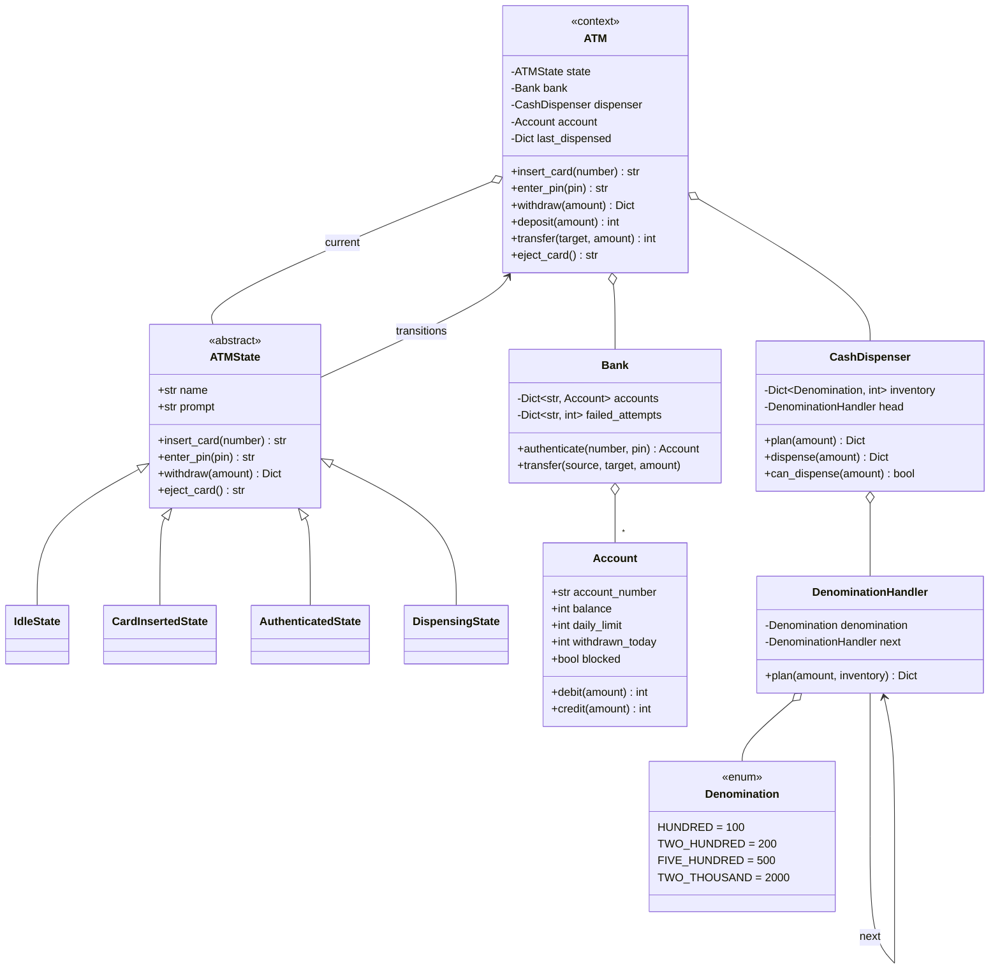
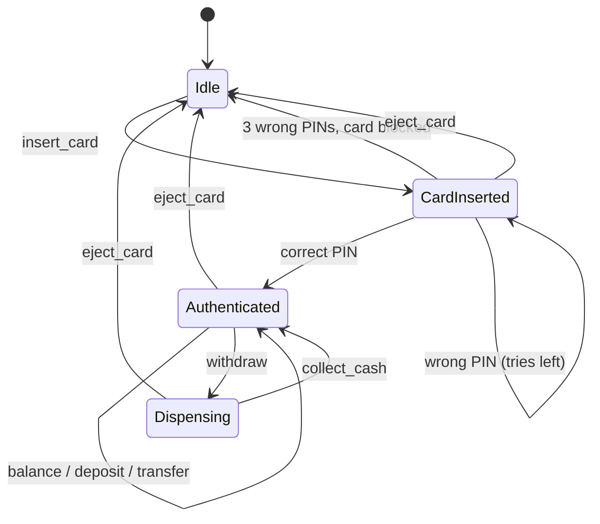

# Design an ATM

> **Difficulty:** 🟡 Medium · **Time:** ~60 min · **Patterns:** State, Chain of Responsibility

Two patterns, each doing real work. The state machine is a **security
boundary**, not a convenience. The dispenser chain has to be all-or-nothing,
because the failure mode is a customer paying for cash they never received.

## The problem

Build the software for a cash machine: read a card, check a PIN, and let the
customer check a balance, withdraw, deposit or transfer — then hand over the
right notes.

## Requirements

1. Insert card → enter PIN → transact → eject.
2. Block a card after three wrong PINs.
3. Withdraw, deposit, transfer, balance enquiry.
4. Dispense using the notes the machine actually holds.
5. Enforce balance and daily withdrawal limits.
6. Refuse any action that does not make sense in the current state.
7. A failed transaction must leave nothing changed.

## Assumptions

- Amounts are integers in the smallest currency unit.
- Notes are 100, 200, 500 and 2000.
- One session at a time.
- The bank is in-process here, standing in for a network call.

## Class diagram



### The session



## How the design works

### The state machine is the security model

`AuthenticatedState` is the **only** state that implements `withdraw`.
Everywhere else inherits the base class's refusal. That is not a stylistic
choice: an ATM that lets you withdraw before authenticating is a security hole,
and a design where the check is a condition somebody has to remember to write
will eventually ship one path where they did not.

Making it structural means "can this happen here?" is answered by which class is
in charge. The tests assert the refusals directly — withdraw with no card,
withdraw with no PIN, balance with no PIN — because those are the cases that
matter most and are easiest to leave untested.

A smaller detail with the same flavour: `IdleState.insert_card` does not check
the card against the bank. Nothing is verified until a PIN arrives, so an
unknown card is indistinguishable from a known one. Otherwise the machine
becomes an account enumeration oracle.

### The dispenser chain, and why it rehearses first

Each handler owns one denomination: take as many of its note as fit, pass the
remainder down. Textbook Chain of Responsibility, used the way the textbook
means it.

What the textbook does not cover is the part that matters. Consider a machine
holding five 2000 notes and asked for 3000:

- 2000 handler: takes one, passes 1000 on
- 500, 200, 100 handlers: hold nothing
- End of chain, 1000 still owing

If those handlers had been **taking** notes rather than planning, the customer's
account is down 3000 and the tray holds 2000. The machine has stolen 1000.

So the chain plans against a copy of the inventory, and only once the whole
amount is known to be makeable does anything move:

```python
def dispense(self, amount):
    plan = self.plan(amount)  # may raise; nothing has changed yet
    for denomination, count in plan.items():
        self.inventory[denomination] -= count  # commit
    return plan
```

There is a test asserting the inventory is byte-for-byte unchanged after a
failed dispense, because "it raised an exception" and "it left nothing broken"
are different claims.

### Order of operations in a withdrawal

Same principle, one level up:

```python
plan = self.atm.dispenser.plan(amount)  # 1. can we even make this?
account.debit(amount)  # 2. take the money
self.atm.dispenser.dispense(amount)  # 3. hand over the notes
```

Debiting first and *then* discovering the machine cannot make the amount means
the customer has paid for cash they never got. Step 3 still has a rollback for
the narrow case where another transaction drains the box in between — which in
a threaded machine is a real race, and the honest answer is that this needs a
lock rather than a `try`.

### Greedy is right here, and not in general

Largest note first is optimal for any **canonical** denomination system, which
100/200/500/2000 is. It is not universally true: with notes of 1, 3 and 4,
greedy makes 6 as 4+1+1 where 3+3 is better.

Naming that limit unprompted usually counts for more than the code does.

### The bank is not part of the machine

`Bank` is a separate object the ATM is handed. In reality it is across a
network and can be slow, wrong, or unreachable, and an ATM that owns its
accounts can be tested against exactly one thing: itself.

Attempt counting lives in the bank, not the machine, for the obvious reason —
three wrong PINs at three different ATMs is still three wrong PINs.

## Running it

```bash
cd problems/atm && python3 src/main.py
```

```
> withdraw 2000             # withdrawing before inserting a card
  refused: Cannot withdraw right now. Please insert your card.

> card 111
  Card accepted. Please enter your PIN.

> withdraw 2000             # withdrawing before entering a PIN
  refused: Cannot withdraw right now. Please enter your PIN.

> pin 1234
  Welcome. Balance: 50000.

> withdraw 7700
  Dispensing 7700: 3 x 2000, 3 x 500, 1 x 200

> withdraw 150              # an amount no combination of notes can make
  refused: 150 cannot be paid in notes; the smallest note is 100
```

Or drive it yourself with `--interactive`.

## Tests

```bash
python3 -m pytest problems/atm -v
```

## Follow-ups an interviewer will ask

- **Power cut between the debit and the dispense.** This is the real version of
  the ordering problem: you need a journal written before the debit and
  reconciled on restart. Ordering alone cannot save you here.
- **Two sessions sharing one cash box.** Where is the race? (Between `plan` and
  `dispense`.) A lock around the dispenser is the smallest correct fix.
- **The bank is unreachable.** Refuse everything, or allow small offline
  withdrawals against a cached balance and reconcile later?
- **Multiple currencies.** One dispenser per currency, or one with typed notes?
- **Card types with different limits and fees.** Strategy on the account, or
  data on the card?
- **Receipts and mini-statements.** `Account.history` is already there; what is
  missing before it could be printed?
