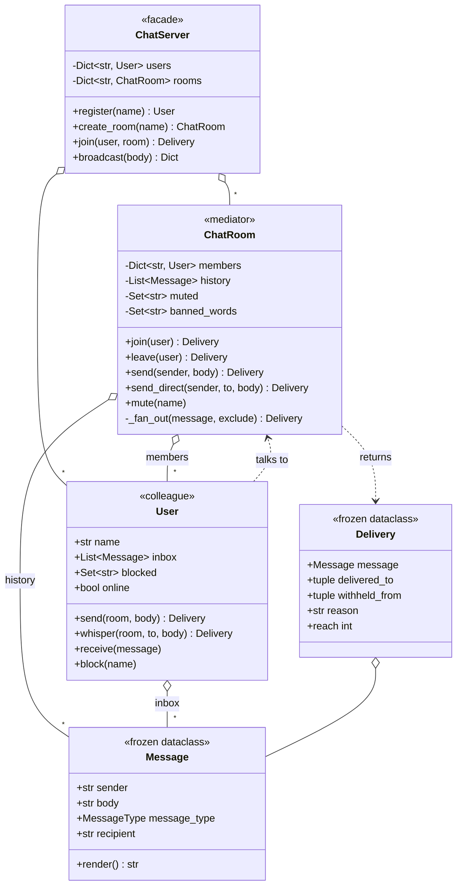

# Design a Chat Room

> **Difficulty:** 🟡 Medium · **Time:** ~50 min · **Patterns:** Mediator, Observer, Facade

The textbook Mediator problem, and a good one because the alternative is so
tempting. Letting users hold references to each other works perfectly for two
people and collapses at ten.

## The problem

Build a chat system: users join rooms, send messages to everyone or to one
person, and can block people they would rather not hear from.

## Requirements

1. Users join and leave rooms; a user can be in several at once.
2. A message reaches everyone in the room except the sender.
3. Direct messages reach one person.
4. A user can block another; blocked messages never arrive.
5. Rooms can mute a user and reject banned words.
6. Rooms keep a transcript, and a late joiner sees the backlog.
7. Users must not hold references to each other.

## Assumptions

- Single process, in memory. A broker is the scaling follow-up.
- Delivery is synchronous into an in-memory inbox.
- Names are unique across the server.

## Class diagram



Note what is **not** on that diagram: any line from `User` to `User`.

## How the design works

### The N² problem

Without a mediator, each user holds a reference to every other user in the
room. That is `N × (N−1)` references, and every one of them has to be created
on join and torn down on leave:

| Members | Peer-to-peer references | With a mediator |
| ---: | ---: | ---: |
| 4 | 12 | 4 |
| 10 | 90 | 10 |
| 50 | 2,450 | 50 |

The count is the least of it. The real cost is that *every* rule about two
users — blocking, muting, moderation — has to be enforced by one of the two
parties, and neither is the right place for it:

- The **sender** cannot enforce a block. It must not learn who blocked it.
- The **recipient** enforcing it means filtering after delivery, so the
  message was already sent.

So the rule goes in the room. `_fan_out` skips the sender, checks each
recipient's block list, and reports what happened. Neither user knows.

### Mediator is not Observer

They look similar and are used for different things. Worth being able to state
the difference:

| | Observer | Mediator |
| --- | --- | --- |
| Shape | one-to-many | many-to-many |
| Subject knows | nothing about listeners | everything about participants |
| Logic | none — it just notifies | routing, filtering, moderation |
| Listeners | may be anything | are the participants |

If the room merely fanned messages out, Observer would be right. But it decides
*who gets what*: it skips the sender, applies blocks, enforces mutes, rejects
banned words, and owns the transcript. That is a mediator, and putting any of
it on a Subject would be a mistake.

The `User` class is the giveaway. Look at what it does not have:

```python
class User:
    def __init__(self, name):
        self.inbox = []
        self.blocked = set()
        self._rooms = []  # mediators, not peers
```

No peer list. No `send_to(other_user)`. A test asserts it, because this is the
sort of thing that erodes the first time someone adds a feature in a hurry.

### Blocks are stated by the user, applied by the room

```python
carol.block("alice")  # carol states the preference
alice.send(room, "hello")  # the room applies it
# -> delivered to 1, withheld from 1
```

Alice's send **succeeds**. It just reaches fewer people. She is not told who
withheld it — which is the point of blocking, and a detail that is easy to
leak through an error message.

### Direct messages stay out of the transcript

Every other path records to `history`. `send_direct` deliberately does not,
because the transcript is replayed to everyone who joins later, and a private
message in it is a privacy breach that ships silently.

That asymmetry is exactly the kind of thing to write a test for, because the
"obvious" refactor — record everything in one place — reintroduces the bug.

### Sends return a result

```python
@dataclass(frozen=True)
class Delivery:
    delivered_to: tuple[str, ...]
    withheld_from: tuple[str, ...]
    reason: str
```

A muted user's message is not an exception — being muted is normal — but it is
also not a success. Returning `None` and hoping makes "why did nobody see my
message?" the hardest class of chat bug to diagnose. The reason travels back
with the result.

## Running it

```bash
cd problems/chat-room && python3 src/main.py
```

```
1. Four people join #general. Each knows the room, not each other.
   members: alice, bob, carol, dave
   peer-to-peer would need 12 references; the mediator needs 4

3. carol blocks alice. The room enforces it; alice is not told who.
   delivered to 2, withheld from 1
   bob sees:   <alice> anyone up for lunch?
   carol sees: <alice> morning all   <- unchanged

4. A direct message goes to one person, and stays out of history.
   dave sees:  [bob → dave] want to grab coffee?
   in transcript: False

5. Moderation lives in the room, because it is about a relationship.
   not delivered (message blocked ('spoiler' is not allowed here))
   not delivered (dave is muted in general)
```

## Tests

```bash
python3 -m pytest problems/chat-room -v
```

## Follow-ups an interviewer will ask

- **Threads and replies.** A message now needs a parent, and the transcript
  stops being a flat list.
- **Read receipts and typing indicators.** These are genuinely Observer —
  high-frequency, low-value events that should not go through the same path as
  messages.
- **Editing and deleting messages.** `Message` is frozen; what replaces it, and
  what does the transcript keep?
- **Several servers.** The room can no longer hold every member in a dict. A
  broker does the fan-out, and the mediator becomes a routing decision.
- **End-to-end encryption.** The room can no longer read message bodies — so
  banned-word moderation stops working. What can a mediator still do when it
  cannot see the content?
- **Rate limiting per user**, to stop flooding. Another rule about a
  relationship, so another thing that belongs in the room.
