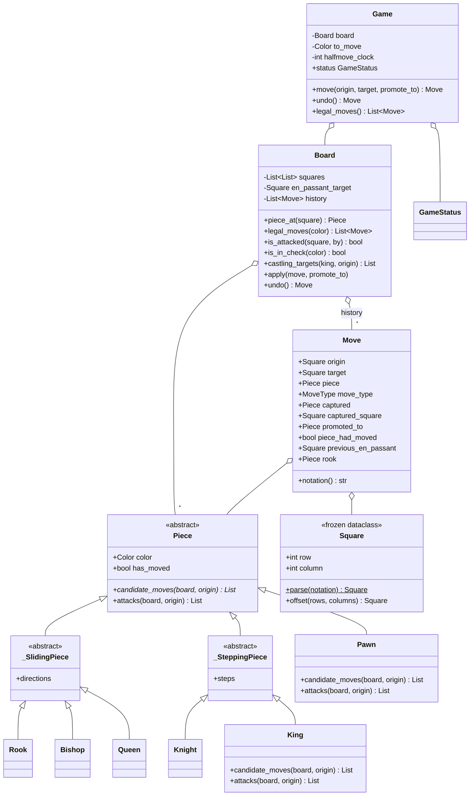

# Design Chess

> **Difficulty:** 🔴 Hard · **Time:** ~90 min · **Patterns:** Strategy, Command, Template Method, Observer

The hardest problem here, and the one where a clean design pays for itself
immediately. Castling, en passant, promotion and pins all look like special
cases to bolt on. They are not — they are what the design has to be shaped
around from the start.

## The problem

Implement chess: the board, all six pieces, whose turn it is, and how a game
ends.

## Requirements

1. All six piece types moving correctly.
2. Turn alternation, captures, and a legal-move check.
3. **Check** — and a move that leaves your own king in check is illegal.
4. **Checkmate** and **stalemate**, told apart correctly.
5. The three special moves: **castling**, **en passant**, **promotion**.
6. Undo.
7. Draws by insufficient material and the fifty-move rule.

## Assumptions

- Standard 8×8, standard starting position.
- Moves are given as origin and destination, not full algebraic notation.
- Threefold repetition is not tracked. It needs position hashing, which is a
  follow-up.

## Class diagram



## How the design works

### Pieces own their movement; the board owns legality

`Board` never asks what kind of piece it is holding. It asks the piece where it
could go. Adding a fairy piece is a new class and no edit anywhere else.

But a piece **cannot** decide whether its move is legal, because that question
is about the whole position — is my king pinned, am I in check, does this
expose my king to a discovered attack. So the responsibility splits:

| | Answers | Knows about |
| --- | --- | --- |
| `Piece.candidate_moves` | how this piece moves, and what blocks it | its own geometry |
| `Board.legal_moves` | whether moving it is allowed | the whole position |

That is the **pseudo-legal / legal** split, and every chess implementation
arrives at it eventually. Arriving at it deliberately is the difference.

The sliding pieces share one outward walk that differs only in direction, so
that walk lives in a base class and `Rook`, `Bishop` and `Queen` are four lines
each. Template Method, earning its keep.

### Make, ask, unmake

There is exactly one correct way to know whether a move leaves your own king in
check: play it, look, take it back.

```python
def _is_safe(self, move):
    self.apply(move)
    safe = not self.is_in_check(move.piece.color)
    self.undo()
    return safe
```

The alternative — reasoning about pins and discovered checks directly — means
reimplementing move generation a second time, in a way that has to agree with
the first. It does not, and the disagreements are subtle.

This is why **undo is on the hot path of the rules themselves**, not behind a
menu item. It runs for every candidate move in every position, so `Move` has to
capture everything needed to reverse it at the moment it is made: the captured
piece *and the square it stood on*, whether the mover had moved before, the en
passant square that was available, the rook involved in castling. None of it
can be recomputed afterwards, because the position it referred to is gone.

A test asserts the board is byte-identical before and after generating legal
moves, because a leak there is completely invisible until it is catastrophic.

### A pawn's attacks are not its moves

Every other piece moves and attacks identically, which makes it natural to
write one method and use it for both. Then a pawn on e5 "attacks" e6, a black
king on e6 is reported as in check, and the bug looks like it is in the king.

So `Piece.attacks` exists alongside `candidate_moves`, identical for everything
except the pawn — which attacks only diagonally, and never the square it pushes
to.

`King.attacks` also overrides, for a different reason: castling is a move, not
an attack. Including it would make `attacks` recursive — deciding whether a king
may castle needs to know which squares the enemy attacks, which would need to
know whether the enemy king may castle.

### The three special moves, and what each one costs

| Move | What it breaks |
| --- | --- |
| **Castling** | Two pieces move at once, and legality depends on move *history* (`has_moved`) and on squares the king merely passes over |
| **En passant** | The captured piece is not on the destination square — the only time that is true |
| **Promotion** | The piece that arrives is not the piece that left |

Each of these is why `Move` carries the fields it does. `captured_square` is
separate from `target` solely because of en passant. `has_moved` lives on the
piece and is restored on undo solely because of castling.

The castling condition people forget is that the king may not pass **through**
an attacked square, not merely avoid ending on one. There is a test for it, and
a companion test asserting that an attack on b1 does *not* prevent queenside
castling — because b1 is not on the king's path, only the rook's.

### Status is read, never stored

```python
@property
def status(self):
    has_moves = bool(self.board.legal_moves(self.to_move))
    in_check = self.board.is_in_check(self.to_move)
    if not has_moves:
        return GameStatus.CHECKMATE if in_check else GameStatus.STALEMATE
```

Caching this means every path that changes the board has to remember to refresh
it, and the one that forgets produces a game still accepting moves after
checkmate.

Those two lines are also the classic chess bug in miniature: **no legal move
plus check is checkmate; no legal move without check is stalemate, and a
draw.** Conflating them hands a win to someone who has just drawn.

### A bug the tests caught

`_is_safe` applies every candidate move, and `apply` fills in a default
promotion piece — a queen. That queen then stuck to the `Move`, so a later
`promote_to=Knight` was silently ignored and every promotion produced a queen.

Checking legality must not be what decides what a pawn promotes to, so
`_is_safe` now puts that choice back exactly as it found it. It is a good
illustration of the cost of make/unmake: anything mutated during the rehearsal
has to be restored, including things that do not look like board state.

### Perft

```bash
cd problems/chess && python3 src/main.py --perft 4
```

```
  perft(1) =        20  [20] ok
  perft(2) =       400  [400] ok
  perft(3) =      8902  [8902] ok
  perft(4) =    197281  [197281] ok
```

Perft counts the positions reachable at a given depth, and the values from the
opening position are published and exact. Matching 197,281 at depth four is far
stronger evidence than any number of hand-written movement tests: it exercises
every piece, every capture, and — because the count would be wrong otherwise —
proves that `undo` fully reverses `apply`.

Depths 1 through 3 are in the test suite. If you only take one idea from this
problem, take this one: when a published oracle exists for your domain, test
against it.

## Running it

```bash
cd problems/chess && python3 src/main.py
```

Plays a short game including castling for both sides, then takes three moves
back:

```
  e2-e4
  e7-e5
  Bf1-c4
  Nb8-c6
  Ng1-f3
  Ng8-f6
  O-O            # White castles kingside
  ...
  Ng5xf7         # a fork on the rook and queen

8 | r . b q . r k .
7 | p p p p . N p p
...
Material — white 39, black 38
black has 33 legal moves.
```

Play both sides yourself:

```bash
cd problems/chess && python3 src/main.py --interactive
```

`moves` lists every legal move, `undo` takes one back.

## Tests

```bash
python3 -m pytest problems/chess -v
```

## Follow-ups an interviewer will ask

- **Threefold repetition.** Needs a hash of the position — including castling
  rights, side to move, and the en passant square, not just the pieces.
- **FEN and PGN.** FEN is a good check on whether your state is complete: if
  you cannot write one, you are missing something.
- **An engine on top.** Minimax with alpha-beta over this move generator is
  the tic-tac-toe answer at a different scale, and `apply`/`undo` already give
  it what it needs.
- **Bitboards.** Legal move generation here is O(pieces × squares × pieces).
  Bitboards make it orders of magnitude faster — and perft is how you prove the
  rewrite did not change the rules.
- **Chess960**, where the back rank is shuffled and castling squares differ.
  How much of `castling_targets` survives?
- **A clock**, with increment and flag-fall. Which object owns the timer?
