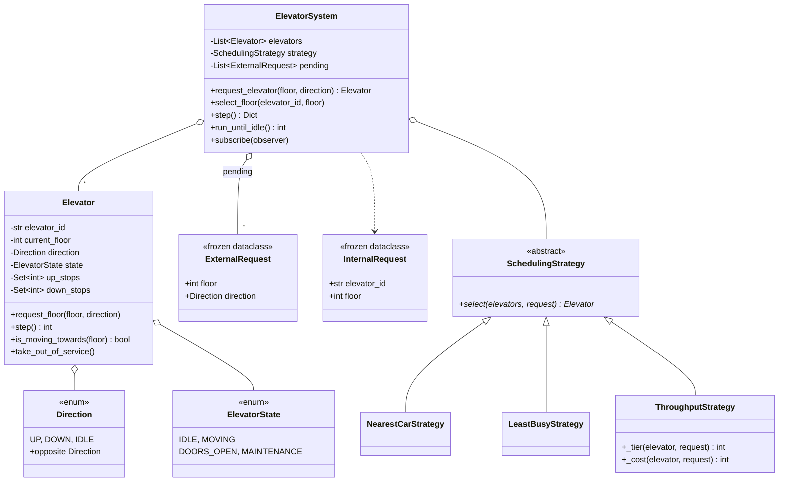
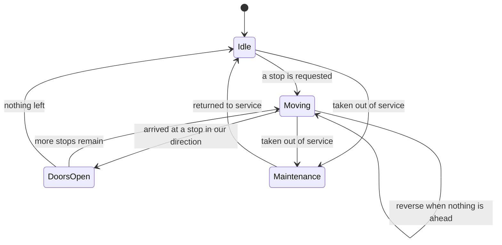

# Design an Elevator System

> **Difficulty:** 🔴 Hard · **Time:** ~75 min · **Patterns:** Strategy, State, Observer

Two separate decisions hide inside this problem, and most answers only find
one. **Which car** answers a hall call is a scheduling question. **What a car
does** once it has work is a completely different algorithm. Keeping them apart
is the design; getting the second one right is the substance.

## The problem

Run a bank of elevators in a building. People press up or down in the lobby;
people inside press a floor. Serve everyone, without anyone waiting forever.

## Requirements

1. Several elevators serving a range of floors.
2. **Hall calls** — a floor plus a direction, from outside.
3. **Car calls** — a destination, from inside a specific car.
4. A car serves stops in a sensible order, not in the order they arrived.
5. Which car answers a hall call must be tunable without changing the cars.
6. Cars can be taken out of service and returned.
7. Nobody is starved.
8. Notify observers when a car serves a floor.

## Assumptions

- Time is a tick. One tick moves a car one floor, or opens its doors.
- Capacity is a rider count, not a weight.
- Single-threaded. Real controllers are concurrent, which is the main follow-up.

## Class diagram



### One car's state machine



## How the design works

### LOOK, not nearest-first

Each car keeps travelling one way, serving every stop on the route, and
reverses only when nothing remains ahead. This is LOOK — a refinement of SCAN,
the disk-head scheduling algorithm — and it is what real elevators do.

The obvious alternative, *always go to the nearest request*, fails badly:

> A car sits on floor 5. Calls arrive for 4 and 20. It serves 4, then heads for
> 20. A new call arrives for 3, so it turns around. Then 6. Then 2.
>
> The person on floor 20 waits forever.

Nearest-first has **no starvation bound**. LOOK does, structurally: a stop ahead
of the car is always reached before the car turns around, so the worst case is
one full sweep. There is a test for exactly this scenario — a stream of nearby
calls must not stop a distant one from being served.

### Direction is part of a stop, not just a floor

This is the detail most implementations miss. A car travelling **up** past
floor 5 must not open its doors for someone on 5 who pressed **down** — they
would be carried the wrong way.

So stops are held in two sets, and the stop check is direction-aware:

```python
def _should_stop_here(self):
    if self.direction is Direction.UP:
        return self.current_floor in self._up_stops
    if self.direction is Direction.DOWN:
        return self.current_floor in self._down_stops
```

Splitting the sets also makes "is there anything further ahead?" — the question
that drives the reversal — a cheap lookup rather than a scan with comparisons.

### Two request types, because they carry different information

| | States | Who can serve it | Goes to |
| --- | --- | --- | --- |
| **Hall call** (`ExternalRequest`) | floor + **direction** | any car | the scheduler |
| **Car call** (`InternalRequest`) | floor + **destination** | only that car | that car's stop list |

Collapsing them into one type throws away the direction on hall calls — which
is precisely the information the stop check above needs. It is the mistake that
makes an elevator design look right and behave wrong.

### Strategy for dispatch, kept out of the car

`Elevator` runs LOOK no matter which strategy picked it. A strategy can be
swapped at runtime and no car notices.

`ThroughputStrategy` is the realistic one. It ranks cars in tiers:

0. **Moving towards the caller, the caller's way.** Free — the car was passing.
1. **Idle.** Free to start a fresh run.
2. **Anything else.** Cost is the detour: run to the end of its current stops,
   then back.

That last calculation is the interesting one. A car three floors away heading
the wrong way is *further* than a car ten floors away heading towards you, and
the cost function says so.

### Ticks, not threads

`step()` advances everything exactly one unit of time. Driving the simulation
a tick at a time is what makes scheduling testable at all — a `run()` that loops
internally can only be checked by its end state, and a threaded version can only
be checked by waiting and hoping.

Real controllers are concurrent. Simulating discrete time and calling that out
explicitly is a much better answer than a thread per elevator and a demo that
passes when the machine is idle.

### Calls are queued, never dropped

If every car is out of service or full, the hall call goes on `pending` and is
retried each tick. A building whose lobby buttons silently do nothing is worse
than one whose lift is slow.

## Running it

```bash
cd problems/elevator-system && python3 src/main.py
```

Eight riders, three cars, fifteen floors, all three strategies:

```
strategy         ticks   floors travelled   stops
--------------------------------------------------
nearest             42                 28      14
least-busy          35                 63      15
throughput          31                 72      13
```

**No strategy wins on both numbers, and that is the point.** `nearest`
concentrates work on the closest car and leaves the others idle — least
distance run, longest wait. `throughput` puts more cars in motion at once, so
it finishes soonest but runs further to do it.

Which one a building wants depends on whether it is paying for electricity or
for people standing in a lobby. An answer that names the trade rather than
declaring a winner is the stronger one.

Watch a single strategy tick by tick:

```bash
cd problems/elevator-system && python3 src/main.py --strategy throughput
```

## Tests

```bash
python3 -m pytest problems/elevator-system -v
```

## Follow-ups an interviewer will ask

- **Run each car on its own thread.** What is shared? (The stop sets, and
  dispatch.) Where is the race between "pick a car" and "assign the call"?
- **Weight, not headcount.** A full car must skip hall calls but still serve
  its own car calls.
- **Express elevators** serving only floors 10–20. Does that go in the car, or
  become a filter in the strategy?
- **Fire mode** — every car to the ground floor, all calls cancelled. Which
  object owns that override?
- **Destination dispatch**, where riders enter their floor in the lobby. This
  changes the problem: the scheduler now knows destinations up front and can
  group riders by where they are going.
- **A car fails mid-journey.** Its stops have to be redistributed, and the
  riders inside it are not represented in this model at all.
