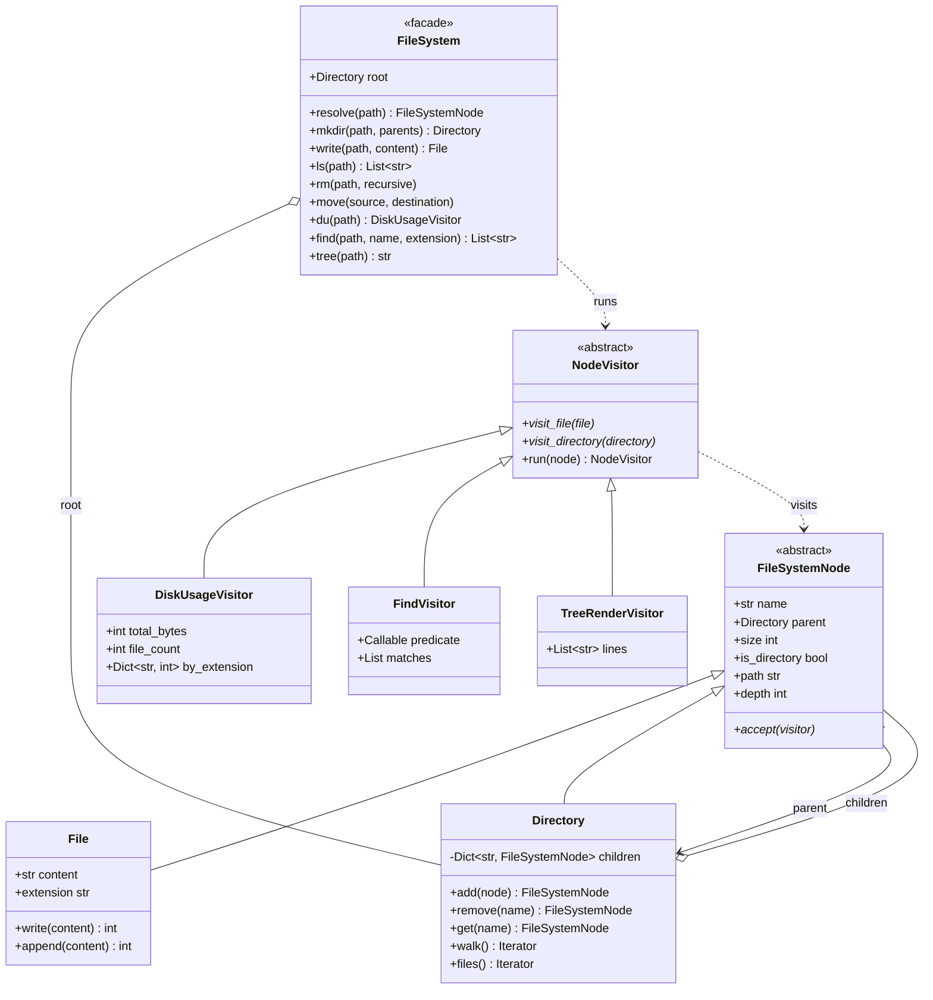

# Design an In-Memory File System

> **Difficulty:** 🟡 Medium · **Time:** ~55 min · **Patterns:** Composite, Visitor, Iterator, Facade

The cleanest Composite problem there is. The design decision is made in the
first thirty seconds — how a directory stores its children — and almost every
difficulty later traces back to getting that one wrong.

## The problem

Build a file system in memory: files, directories, paths, and the commands you
would expect — `ls`, `mkdir`, `read`, `write`, `rm`, `mv`, `du`, `find`.

## Requirements

1. Directories contain files **and** other directories, to any depth.
2. A directory's size is everything beneath it.
3. Resolve absolute paths, including `.` and `..`.
4. The usual commands, with specific errors rather than generic ones.
5. Search by name, by extension, or by an arbitrary predicate.
6. Render the tree.
7. Adding a new operation must not mean editing the node classes.

## Assumptions

- Single-threaded, entirely in memory.
- No symlinks, permissions or file handles — all follow-ups.
- Paths are absolute. Sizes are UTF-8 byte counts.

## Class diagram



## How the design works

### The decision that makes or breaks this

A directory can hold two kinds of thing. The obvious model:

```python
class Directory:
    files: list[File]
    subdirectories: list[Directory]  # don't
```

It reads fine and it is wrong. Every traversal is now written **twice**, once
per list, forever — size, search, rendering, move, delete. The two copies drift,
and the bug is always in whichever one you wrote second.

Composite says: one list, one type.

```python
class Directory(FileSystemNode):
    _children: dict[str, FileSystemNode]
```

`File` and `Directory` both implement `size`, `path`, `accept`. A caller holding
a `FileSystemNode` never asks which it has:

```python
return sum(child.size for child in self._children.values())
```

That line is the entire recursive size implementation, and it works because a
file answers `size` just as readily as a directory does.

`is_directory` still exists for the few callers that genuinely must
distinguish — `ls` marks directories with a slash. But it is the exception, and
it is explicit rather than an `isinstance` scattered through the traversals.

### Size is derived, never cached

```python
@property
def size(self) -> int:
    return sum(child.size for child in self._children.values())
```

Caching it means invalidating up the entire ancestor chain on every write, and
the one path that forgets leaves a directory permanently reporting the wrong
number — with nothing to indicate it. Derive first; cache only when a profiler
says to, and then test the invalidation harder than the calculation.

### Visitor, and the trade it makes

Disk usage, search and rendering are the same traversal with different
bookkeeping. Put each on the nodes and every new operation edits both `File`
and `Directory`, which slowly become a junk drawer of unrelated methods.

As visitors, a new operation is one new class and nothing existing changes.

The trade is the one Visitor always makes, and it is worth naming out loud:

| | Composite-only | With Visitor |
| --- | --- | --- |
| New **operation** | edit every node class | one new class |
| New **node type** | one new class | edit every visitor |

For a file system that is the right way round — there are two node types and
there will always be two, while operations keep arriving. For a design where
new node types are the common change, Visitor is the wrong pattern and you
should say so.

### Cycles are a real risk, not a theoretical one

```python
b.add(a)  # where a is b's parent
```

The tree now has a cycle, and the next recursive `size` call never returns. It
is an easy mistake for a user of the API to make, so `add` walks the parent
chain and refuses:

```python
if isinstance(node, Directory) and self._is_inside(node):
    raise ValueError(f"Cannot add {node.path} into its own descendant {self.path}")
```

### `..` is resolved during the split, not after

```python
if part == "..":
    if parts:
        parts.pop()
    continue
```

Popping an empty list is a no-op, so `/../../..` resolves to the root rather
than walking off the top of the tree. Resolving afterwards means handling "we
went above the root" as a special case; resolving during means it cannot happen.

### Failed operations leave nothing half-done

`move` validates the destination **before** detaching the node:

```python
if name in parent:
    raise FileExistsError(...)  # nothing has moved yet
node.parent.remove(node.name)
```

The other order orphans the node on failure: removed from where it was, never
added to where it was going, and unreachable from the root. A test asserts the
node is still in place after a refused move.

### Generators, not lists

`walk()` yields. A deep tree should not have to be materialised in full just to
find the first match, and `find` stops caring how big the tree is.

## Running it

```bash
cd problems/file-system && python3 src/main.py
```

```
/  [220]
├── docs/  [9]
│   └── guide.md  [9]
├── src/  [80]
│   └── demo/  [80]
│       ├── utils/  [34]
│       │   └── text.py  [34]
│       ├── __init__.py  [0]
│       ├── core.py  [25]
│       └── models.py  [21]
├── tests/  [65]
...

220 bytes across 9 files in 6 directories
  by extension: md 51b, py 145b, toml 24b

Moving a directory carries everything under it:
  /lib/demo/utils/text.py exists: True
  /src now holds: (nothing)

  /nope.txt            PathNotFound: No such file or directory: /nope.txt
  /README.md/inner     NotADirectory: /README.md is a file, so /README.md/inner cannot exist
```

Or explore it yourself with `--interactive`.

## Tests

```bash
python3 -m pytest problems/file-system -v
```

## Follow-ups an interviewer will ask

- **Symbolic links.** The tree stops being a tree. What does recursive size do
  when a link points at an ancestor?
- **Permissions and ownership.** On the node, or a separate table? What does
  `find` do with a directory it cannot read?
- **Snapshots** of a subtree, copy-on-write. Nodes become immutable, and
  sharing structure between versions gets interesting.
- **File handles** with seek and offsets. `File` currently has no notion of a
  reader.
- **Now cache directory sizes.** The interesting half is invalidation: which
  nodes, in what order, and what happens on a failed write?
- **Concurrent readers and writers.** A lock per directory, or one per tree?
