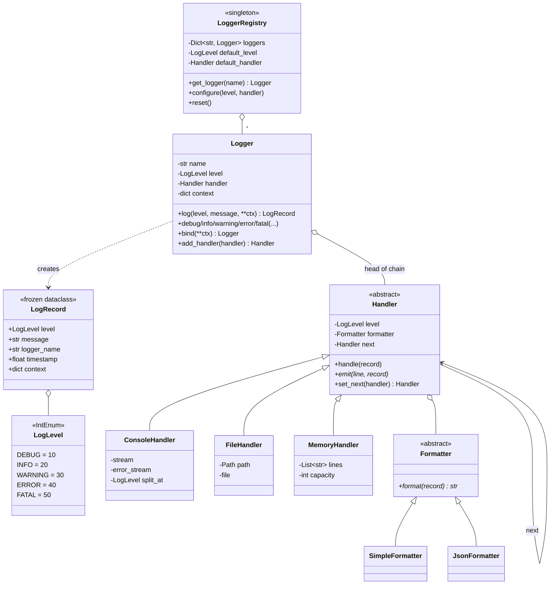
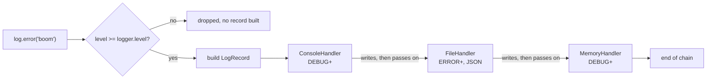

# Design a Logging Framework

> **Difficulty:** 🟡 Medium · **Time:** ~45 min · **Patterns:** Chain of Responsibility, Strategy, Singleton

One of the few problems where Singleton is the right answer rather than the
reflex answer. It is also a good test of whether you apply a pattern or adapt
it — the textbook chain stops at the first handler, and for logging that is
wrong.

## The problem

Build a logging framework. Application code calls `log.info("...")`; the
framework decides which of several destinations that record reaches, and in
what format.

## Requirements

1. Severity levels: DEBUG, INFO, WARNING, ERROR, FATAL.
2. Several destinations at once — console, file, memory — each with **its own**
   threshold, so a file can take only errors while the console takes everything.
3. Pluggable formatting (plain text, JSON), independent of destination.
4. One named logger per name, process-wide.
5. Configuration applied after loggers are handed out must still reach them.
6. A message below the threshold should cost almost nothing.

## Assumptions

- Single process. Async delivery and log rotation are follow-ups.
- Timestamps come from an injected clock.
- Handlers write synchronously.

## Class diagram



### How a record travels



## How the design works

### The chain does not stop

The textbook Chain of Responsibility passes a request along until one handler
takes it, then stops. That is right for an approval workflow, where exactly one
approver should own a request.

It is wrong for logging. An ERROR should reach the console **and** the file
**and** the alerting sink. So every handler here looks at every record, writes
it if it clears its own threshold, and passes it on either way:

```python
def handle(self, record):
    if record.level >= self.level:
        self.emit(self.formatter.format(record), record)
    if self._next is not None:
        self._next.handle(record)  # unconditional
```

Naming that departure — and why — is worth more in an interview than
reproducing the pattern as printed.

### Two thresholds, doing different jobs

The **logger's** level is a cheap gate: it runs before the record is built, so a
disabled DEBUG call costs one integer comparison rather than an allocation and a
walk down the chain. `logger.debug(...)` returning `None` is what a test asserts
to prove the work really was skipped.

Each **handler's** level then decides that handler's own output. This is what
lets one chain send everything to the console and only errors to a file.

### Formatter is separate from handler

Format and destination vary independently — JSON on disk, plain text on the
console, or the same in both. Folding formatting into the handler would need a
class per combination: `JsonFileHandler`, `PlainFileHandler`, and so on.

`emit` receives the record alongside the formatted line so a handler can route
on level without parsing its own output back out. The first version of
`ConsoleHandler` searched the line for `[ERROR]` to pick a stream, which broke
the moment a JSON formatter was attached.

### Singleton, for once, on purpose

`LoggerRegistry` is a real singleton because the thing being shared is genuinely
global. Two registries would mean `get_logger("app")` returning different
loggers depending on which module asked, and configuration applied in one place
silently not taking effect in another.

Double-checked locking makes the first call safe from several threads; the
cheap read outside the lock keeps every subsequent call off it.

The honest caveat, which is worth volunteering: this makes the registry hard to
isolate in tests. That is why `reset()` exists, why the test suite has an
autouse fixture calling it, and why `Logger` is an ordinary class you can
construct directly without going near the registry at all.

### `bind` for request context

```python
request_log = log.bind(request_id="req-8814", user="alice")
request_log.info("GET /orders")
request_log.error("Upstream timeout", status=504)
```

Both records carry the request id. Without this, correlating fields get threaded
through every function that might log, which is how they end up missing from
exactly the records you need them on. Per-call fields override bound ones.

## Running it

```bash
cd problems/logging-framework && python3 src/main.py
```

```
2026-09-19 06:27:43 [INFO] app: GET /orders request_id=req-8814 user=alice
2026-09-19 06:27:43 [ERROR] app: Upstream timeout request_id=req-8814 status=504 upstream=payments user=alice

7 records passed through the chain.
2 of them reached /tmp/lld-logging-a1b2c3/errors.jsonl:

{"level": "ERROR", "logger": "app", "message": "Upstream timeout", "request_id": "req-8814", "status": 504, "timestamp": 1789799263.605953, "upstream": "payments", "user": "alice"}
{"level": "ERROR", "logger": "db", "message": "Connection pool exhausted", "size": 20, "timestamp": 1789799263.6060832, "waiting": 7}
```

## Tests

```bash
python3 -m pytest problems/logging-framework -v
```

## Follow-ups an interviewer will ask

- **Make logging asynchronous.** A queue plus a writer thread. What happens
  when the queue is full — block, or drop? What about records still queued at
  shutdown?
- **Rotate the log file** at a size or a date. Does that belong in
  `FileHandler` or in a sink it writes to?
- **Rate-limit repeated identical messages** so one hot loop cannot fill the
  disk. A decorating handler, not a change to any existing one.
- **Hierarchical loggers** — `app.db.pool` inheriting from `app.db` from `app`.
  What does a record do when the child has no handler?
- **Thread safety on the handlers.** Two threads writing to one file handler is
  a real race; `Logger` is already effectively read-only after configuration.
- **Redact secrets before they are written.** A formatter, or a filter step in
  the chain?
