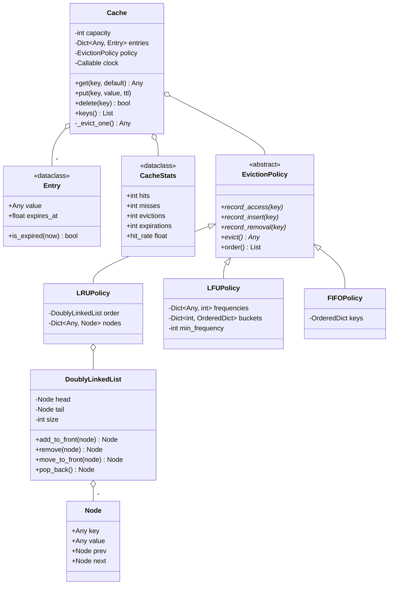

# Design an LRU Cache

> **Difficulty:** 🟡 Medium · **Time:** ~45 min · **Patterns:** Strategy, Template Method

Half a DSA problem and half a design problem. The `O(1)` requirement forces one
specific data structure; the "now make it LFU" follow-up forces one specific
seam. Answers that only do the first half get stuck on the second.

## The problem

Build a fixed-capacity key/value cache. When it is full, something has to be
thrown out, and the rule for choosing what gets thrown out must be swappable
without rewriting the cache.

## Requirements

1. `get` and `put` must both be **O(1)**.
2. When the cache is full, evict according to a policy: **LRU** (least
   recently used), **LFU** (least frequently used) or **FIFO**.
3. Reading a key counts as using it, under LRU.
4. Overwriting an existing key must not evict anything.
5. Keys can carry a TTL and expire on their own.
6. Report hits, misses and evictions.

## Assumptions

- Single-threaded. Locking is the first follow-up.
- Capacity is a count of entries, not bytes.
- Values are opaque; the cache never inspects them.

## Class diagram



## How the design works

### Why a hash map *and* a linked list

Neither structure alone can do the job:

| | Lookup | Reorder on use | Find the victim |
| --- | --- | --- | --- |
| Hash map alone | O(1) | — no ordering | O(n) |
| Linked list alone | O(n) | O(1) once you have the node | O(1) |
| **Both** | **O(1)** | **O(1)** | **O(1)** |

The map gets you to the node; the list reorders it. That pairing is the answer
to "make it O(1)", and it is why `Node` carries its own `key` — on eviction you
start from the tail node and need to know which map entry to delete.

The list uses permanent **sentinel** head and tail nodes that never hold data.
That single trick removes every null check from the pointer surgery: a real
node always has a node on both sides of it, so `remove` is four assignments
with no special cases for the ends.

Python has `OrderedDict`, which would make this about ten lines. Writing the
list out is the point of the exercise — and `FIFOPolicy` does use an
`OrderedDict`, precisely because FIFO never needs to reorder.

### Strategy, for the eviction rule

`Cache` never learns what LRU means. It reports three events — access, insert,
removal — and asks for a victim when it needs space. Every policy method must
be O(1), which is what forces each policy to carry its own bookkeeping rather
than scanning the key set at eviction time.

Swapping the rule is a constructor argument:

```python
Cache(capacity=100, policy="lru")
Cache(capacity=100, policy="lfu")
```

### LFU in O(1)

The naive LFU keeps a count per key and scans for the minimum on eviction,
which is O(n) and quietly breaks the headline requirement. Instead, keys are
grouped into an ordered bucket per frequency, and the minimum is maintained
incrementally.

`_min_frequency` only ever moves two ways: it resets to 1 on any insert, and it
steps up by exactly one when the bucket it points at empties because its last
key was promoted. It never needs to search. Ties inside a bucket break by
recency, which is why the buckets are `OrderedDict`s rather than sets.

### Two bugs this design avoids by construction

**Overwrite is not insert.** `put` on an existing key updates in place and
records an *access*, never an insert. Treating it as an insert evicts a live
key on every update — the cache slowly empties itself under a write-heavy
workload while reporting a healthy size.

**Expired beats unexpired.** `_evict_one` clears anything already dead before
asking the policy for a live victim. Without that, a cache full of expired
entries evicts perfectly good keys to make room.

### The clock is an argument

`Cache` takes a `clock` callable, defaulting to `time.monotonic`. TTL tests
advance a `FakeClock` instead of sleeping, so the whole suite runs in
milliseconds and the assertions are exact rather than flaky.

## Running it

```bash
cd problems/lru-cache && python3 src/main.py
```

It replays one access pattern under all three policies. They disagree, which is
the interesting part:

```
--- LRU, capacity 3 ---
  get a     hit (1)   -> ['a', 'c', 'b']
  put e=5   -> ['e', 'd', 'b']
  survivors: ['b', 'd', 'e']

--- LFU, capacity 3 ---
  get a     hit (1)   -> ['a', 'b', 'd']
  put e=5   -> ['a', 'b', 'e']
  survivors: ['a', 'b', 'e']

--- FIFO, capacity 3 ---
  get a     MISS      -> ['d', 'c', 'b']
  survivors: ['c', 'd', 'e']
```

`a` is read four times. LFU keeps it, LRU loses it to newer arrivals, FIFO
never counted the reads at all.

## Tests

```bash
python3 -m pytest problems/lru-cache -v
```

## Follow-ups an interviewer will ask

- **Make it thread-safe.** One lock around the whole cache is correct and
  simple. Sharding by key hash is the next step. Lock-free is a research
  project — say so rather than sketching one.
- **Capacity in bytes, not entries.** Eviction becomes a loop, not a single
  call, and entries need a size.
- **Write-through to a backing store.** Does `put` block on the write? What
  happens when the store is down?
- **A cache of caches, per tenant.** Where does the global capacity limit live?
- **Expire keys eagerly rather than on read.** A background sweep, or a heap
  ordered by expiry — what does each cost?
- **Why not just `OrderedDict`?** Good answer: for production, use it. The
  hand-written list is here to show you know what it does.
