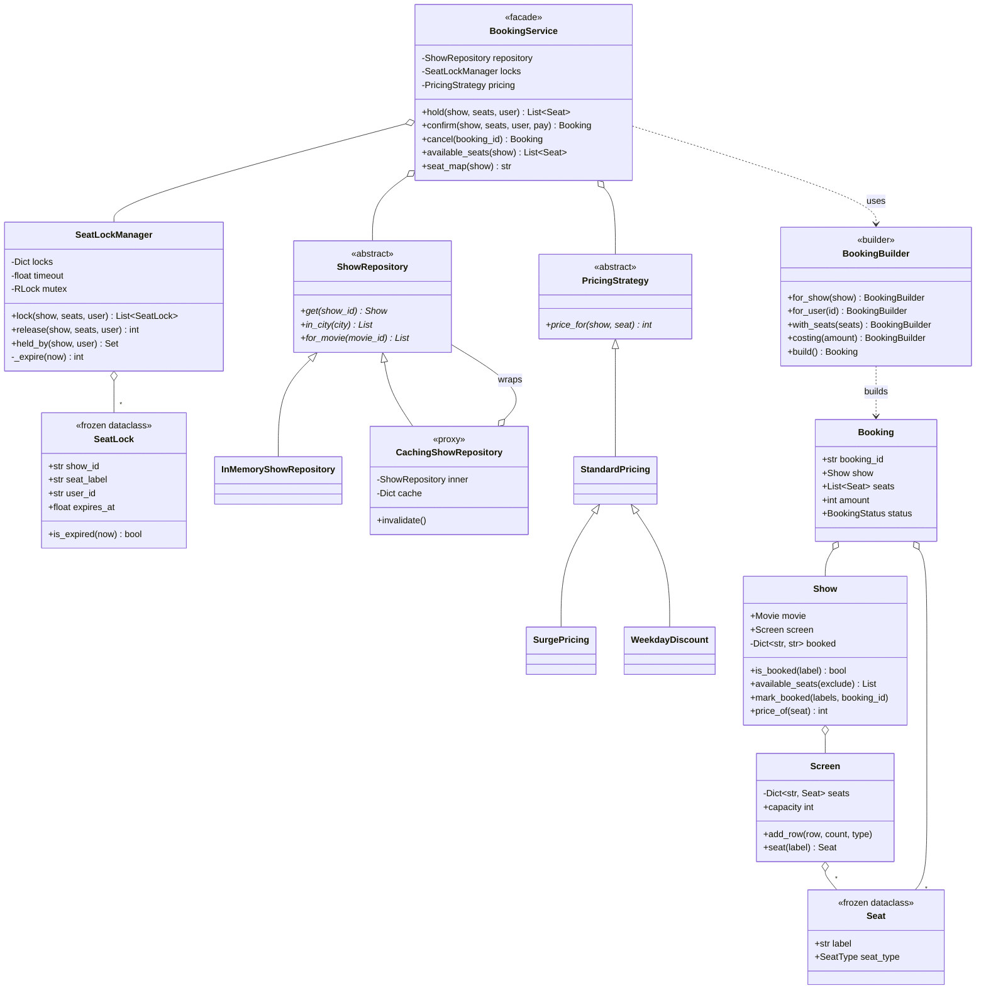
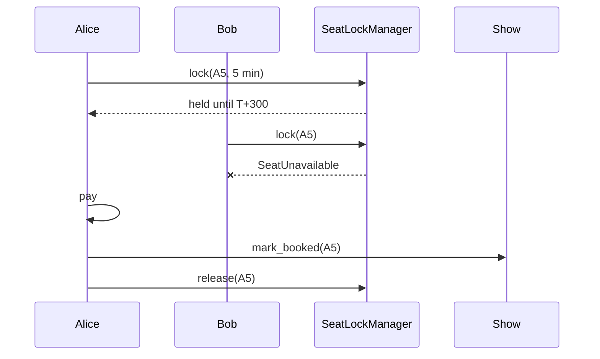

# Design a Movie Ticket Booking System

> **Difficulty:** 🔴 Hard · **Time:** ~80 min · **Patterns:** Builder, Repository, Proxy, Strategy, Facade

This problem is asked for exactly one reason: **two people click the same seat
at the same moment.** Everything else — catalogue, pricing, seat maps — is
bookkeeping. If an answer does not deal with that race, it has not answered the
question.

## The problem

Build a ticket booking system. Users browse shows, pick seats, pay, and get a
booking. The same seat must never be sold twice.

## Requirements

1. Movies, theatres, screens with seat layouts, and shows.
2. Browse shows by city and by movie.
3. Select seats, see what is free.
4. Price by seat class, with pluggable pricing.
5. Pay, then confirm.
6. **The same seat must never be sold twice**, no matter the timing.
7. An abandoned checkout must not hold seats forever.
8. Cancel a booking and return the seats.

## Assumptions

- Amounts are integers in the smallest currency unit.
- Payment is an injected callable standing in for a gateway.
- Single process. The locking section says what changes when it is not.

## Class diagram



## How the design works

### The race, and the lease that closes it

Two users click A5. Both flows check availability, both see it free, both take
payment, both write a booking. One of them turns up to find someone in their
seat.

The fix is a **short-lived exclusive hold**, taken when seats are selected:



A lock is a **lease**, not a booking:

- taken before payment, so nobody else can start paying
- **expires on its own**, so an abandoned checkout does not hold seats forever
- converted to a booking on payment, or dropped

The expiry is what people leave out, and it is the part that matters. A hold
with no timeout means one person closing their laptop takes those seats out of
circulation permanently.

### Where payment goes in the sequence

```python
1. lock the seats     # exclusive, and it expires
2. price them
3. take payment       # the slow, failure-prone step
4. confirm            # write the booking
5. release the lock
```

Payment happens **inside** the lock. That is the whole point:

- pay **before** locking → two people both pay for A5
- confirm **before** paying → a seat is sold that nobody paid for

And a declined payment releases the hold immediately rather than waiting out
the timeout. Five minutes of dead seats after a *known* failure is a business
cost, not a technical one.

### All or nothing

```python
taken = [label for label in seat_labels if held_by_someone_else(label)]
if taken:
    raise SeatUnavailable(...)  # before anything is claimed
```

Claiming three of five seats and failing on the fourth leaves a party split
across the auditorium, holding seats they did not ask for. The check runs
against every requested seat before a single one is taken — and a test asserts
that a failed hold claims nothing.

### Availability belongs to the show

The tempting model puts `booked: bool` on `Seat`. It is wrong, and the failure
is obvious once stated: booking A1 for the 6pm show marks it taken at 9pm too.

A `Seat` is a physical fact about a screen. Availability is a fact about a
*show*, so `Show` owns the booked map — and there is a test for exactly that
confusion.

### Two kinds of "not free", kept apart

| | Lives in | Duration | Reversible |
| --- | --- | --- | --- |
| **Held** | `SeatLockManager` | minutes | expires by itself |
| **Booked** | `Show._booked` | permanent | only by cancelling |

The seat map shows all three states — `.` free, `o` held, `#` booked — because
merging held and booked into one flag loses the ability to expire one and not
the other.

### The mutex is not decoration

```python
with self._mutex:
    now = self.clock()
    self._expire(now)
    taken = [...]  # check
    self._locks[key] = ...  # and claim
```

Check-then-claim is a race even in a single process with threads. Between the
check and the claim, another thread can do both.

There is a test with twenty threads on a barrier all grabbing one seat, and it
asserts **exactly one winner**. That test fails without the lock.

In production this moves to Redis with a TTL, because the guarantee has to hold
across processes — but the shape is identical: an atomic claim, a timeout, an
owner.

### Builder, Repository, Proxy

**Builder**, because a booking is assembled across several screens — show on
one, seats on the next, payment on a third — with several optional pieces. The
alternative is an eight-argument constructor, five of them optional, and a
half-built `Booking` floating around invalid. `build()` reports **every**
missing field at once rather than failing on the first, so a caller does not fix
one thing and resubmit to find the next.

**Repository**, so `BookingService` never learns where shows come from. Swapping
in a database is a new implementation and no change to any caller.

**Proxy** — `CachingShowRepository` implements the same interface, holds the
real repository, and controls access by remembering answers. Listings are read
constantly and change rarely, which is exactly when that pays. The demo does
five listings and makes one query.

The important half is `add` clearing the cache. A proxy that caches reads and
forgets to invalidate on write is *worse* than no proxy, because it is
confidently wrong. Both behaviours have tests, as does the one that matters
most: a caller cannot tell which repository it was handed.

### An honest note on the pricing classes

`SurgePricing` and `WeekdayDiscount` subclass `StandardPricing`. For a real
system they should **decorate** it, so a weekday surge discount composes instead
of needing a fourth class. They are subclasses here to keep the example short,
and it is better to say so than to present it as the recommended shape.

## Running it

```bash
cd problems/movie-ticket-booking && python3 src/main.py
```

```
2. alice holds A1 and A2. bob cannot touch them.
   bob: Someone else is holding: A2
   and A3 was not claimed either: True

3. Payment happens inside the hold. A decline frees the seats at once.
   Payment of 300 was declined
   B1 is free again immediately: True

5. An abandoned checkout expires rather than holding seats forever.
   carol holds C1, C2 — free seats now: 16
   five minutes later, the hold lapsed  — free seats: 18

6. Twenty people click the same seat at once.
   1 winner (user19), 19 turned away

8. The caching proxy is indistinguishable from the real repository.
   5 listings -> 1 repository queries (4 cache hits, 80%)
```

## Tests

```bash
python3 -m pytest problems/movie-ticket-booking -v
```

## Follow-ups an interviewer will ask

- **Locks in Redis.** `SET key value NX PX 300000` is the atomic claim.
  Releasing needs a check-and-delete script, or you release someone else's lock
  after yours expired.
- **Group booking** — "four seats together". Allocation stops being "are these
  free" and becomes "find a contiguous run", which changes the interface.
- **Coupons and loyalty points.** Now pricing genuinely needs a chain, and the
  subclass shortcut above stops working.
- **Refunds** with a time-based policy. Full before 24 hours, half after — and
  what happens to a cancelled seat mid-show?
- **Waitlists.** When a booking is cancelled, who gets told, and how long do
  they have?
- **The payment gateway times out.** You do not know whether the charge went
  through. This is the hardest case in the problem: you need an idempotency key
  and a reconciliation job, and the lock has to outlive the request.
