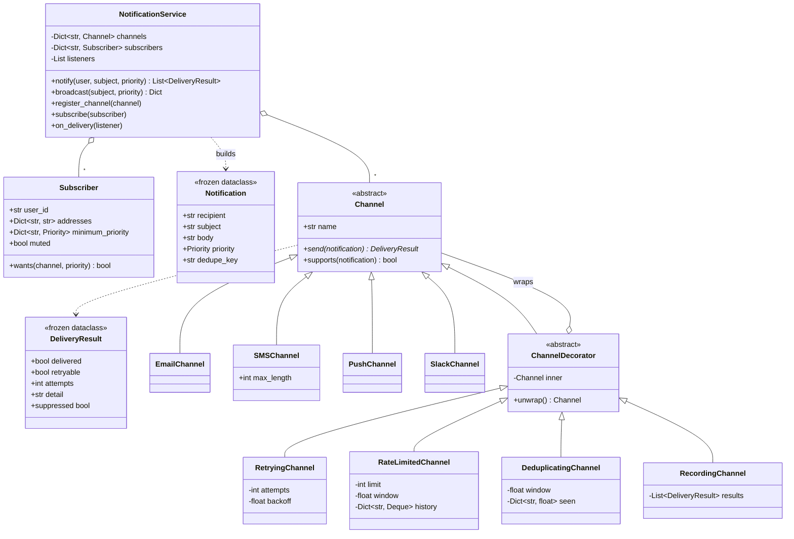

# Design a Notification Service

> **Difficulty:** 🟡 Medium · **Time:** ~55 min · **Patterns:** Decorator, Observer, Factory Method, Strategy

The problem looks like "write four send methods". It isn't. Everything
interesting — retrying, rate limiting, deduplication — applies to all four
channels equally, and where you put that logic is the entire design decision.

## The problem

Send notifications to users over several channels, honouring each user's
preferences, without the same reliability logic being written four times.

## Requirements

1. Several channels: email, SMS, push, Slack.
2. Each subscriber chooses which channels they want and a **minimum priority
   per channel** — everything by email, only urgent things by SMS.
3. Retry transient delivery failures with backoff.
4. Rate limit per recipient, so nobody gets flooded.
5. Deduplicate: a flapping alert must not send forty identical emails.
6. Report the outcome of every attempt.
7. Adding a channel must not require touching the reliability logic, and adding
   a reliability policy must not require touching the channels.

## Assumptions

- Delivery is synchronous. A queue is the first follow-up.
- Transports are injected; the demo prints instead of sending.
- Clocks are injected, so no test sleeps.

## Class diagram



## How the design works

### Decorator, because the policy is orthogonal to the channel

Retrying, rate limiting and deduplication apply equally to all four channels.
There are three obvious places to put them, and two are wrong:

- **In each channel** — four copies of each policy, drifting apart.
- **In the service** — every channel gets the same policy whether it suits it
  or not, and the service grows a flag per policy.
- **As decorators** — written once, composing with any channel.

The thing that makes it work is that every decorator **is itself a `Channel`**.
The wrapper and the wrapped are the same type all the way down, so a stack
composes to arbitrary depth and the service cannot tell the difference:

```python
RetryingChannel(
    RateLimitedChannel(DeduplicatingChannel(EmailChannel()), limit=3, window=60), attempts=2
)
```

### Order is not a detail

Two stacks of the same three decorators do different things, and the tests pin
both down rather than leaving it to chance:

**Retry outside the limiter** — each retry is re-checked against the rate
limit. A single logical send may be rejected part-way through its attempts.

**Retry inside the limiter** — the limiter sees one send, not three attempts.
The retries are invisible to it, so one logical notification consumes one unit
of budget however many times it bounced.

The second is usually what you want, because the budget should count
notifications a person receives, not TCP attempts. Being able to say *why* you
stacked them the way you did is the answer to this problem.

### Suppressed is not failed

This one only showed up when the demo was run, and it is the most useful thing
here.

Both a duplicate and a rate-limited send come back as "not delivered". If that
is all `RetryingChannel` knows, it dutifully retries them — burning two extra
attempts and a backoff sleep to arrive at exactly the same answer, and
reporting `failed after 2 attempts (duplicate)`, which reads like a bug.

So `DeliveryResult` carries `retryable`:

```python
if not result.retryable:
    return result  # suppressed on purpose; trying again cannot help
```

A transport timeout is retryable. A deliberate suppression is not. The
distinction matters far beyond wasted attempts: a dashboard that counts
suppressions as failures shows an outage every time deduplication does its job.

### Preferences are per channel, not per user

```python
Subscriber(
    "alice",
    addresses={"email": "alice@example.com", "sms": "+15550101"},
    minimum_priority={"sms": Priority.URGENT},
)
```

Alice gets everything by email and only urgent things by text. A single
per-user threshold cannot express that, and the result is a system people mute
entirely rather than tune.

### Transports and clocks are injected

A channel that constructs its own SMTP client can only be tested by standing up
an SMTP server. A retry decorator that calls `time.sleep` directly turns a fast
suite into a slow one — and, in practice, into an untested one. Both are
parameters here, which is why the whole suite runs in milliseconds.

## Running it

```bash
cd problems/notification-service && python3 src/main.py
```

```
1. A normal notification. SMS is skipped: Alice set it to urgent-only.
   email: delivered

2. The same alert four times, as a flapping check would send it.
   attempt 1: email: delivered
   attempt 2: email: suppressed (duplicate of a notification sent 0s ago)
   attempt 3: email: suppressed (duplicate of a notification sent 0s ago)
   attempt 4: email: suppressed (duplicate of a notification sent 0s ago)

3. An urgent one. Now SMS and push both qualify.
   email: delivered
   sms: delivered (37 chars)
   push: delivered
```

## Tests

```bash
python3 -m pytest problems/notification-service -v
```

## Follow-ups an interviewer will ask

- **Make delivery asynchronous.** A queue and workers. Where does the dead
  letter queue go, and who reads it?
- **Fall back to the next channel** when the preferred one fails. Note that
  this is Chain of Responsibility, not another decorator — the decorators here
  all wrap *one* channel.
- **Templating and localisation.** Does the template render before or after the
  channel is chosen? (After — SMS and email want different lengths.)
- **Digests.** "Everything from the last hour, once" is a different shape from
  everything here: it needs to hold notifications back, not just drop them.
- **A circuit breaker** so a dead provider is not hammered. Another decorator —
  and it has to interact correctly with the retry above it.
- **Quiet hours and time zones.** Delay rather than suppress, which again means
  holding notifications rather than dropping them.
