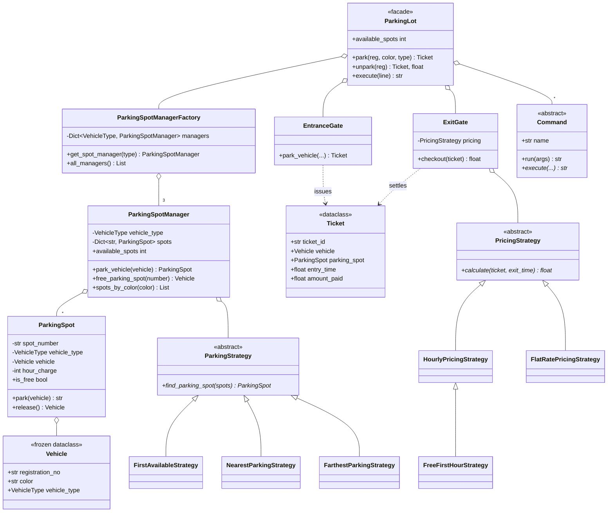

# Design a Parking Lot

> **Difficulty:** 🟡 Medium · **Time:** ~60 min · **Patterns:** Strategy, Factory Method, Command, Facade

The most-asked machine coding problem there is, and the one people most often
over-build. The trap is making a class for every difference instead of asking
which differences are behaviour and which are just data.

## The problem

Design a parking lot that hands out spots to arriving vehicles, tracks what is
parked where, charges for the stay on the way out, and answers questions about
its contents — all from a command line.

## Requirements

1. Handle several categories of vehicle: two-wheelers, four-wheelers and
   oversized vehicles (HUVs). A vehicle may only use a spot of its category.
2. Assign a spot on entry and free it on exit.
3. Report how many spots are free.
4. Record each vehicle's registration number and colour.
5. Find vehicles by colour, and by registration number.
6. List everything currently parked.
7. Charge for the stay on exit.
8. Spots can be added to and removed from the lot while it is running.

## Assumptions

- Spot numbers are strings, because real lots use labels like `B2-014`. The
  demo happens to use plain integers.
- A vehicle is identified by its registration number, and the same plate cannot
  be parked twice at once.
- The lot is single-threaded. Concurrency is the first follow-up below.

## Class diagram



## How the design works

**Two strategies, because there are two independent decisions.** Which spot a
car gets and what the stay costs change for completely different reasons — one
is an operations call, the other a pricing call. Folding them into one
interface would mean a new pricing rule forces you to think about spot
allocation.

**Factory, to guarantee one manager per category.** Every gate and every command
gets its manager from `ParkingSpotManagerFactory`. That single-instance
guarantee is the whole job: two gates each holding their own idea of which
spots are free is exactly the bug this prevents.

**Command, so adding an operation never edits an existing one.** Each operation
is a class declaring its own name, arity and help text. The dispatcher is a
dictionary lookup. The usual version of this — one `execute()` with a long
`if/elif` chain — means every new command edits the same method and the arity
check gets copy-pasted per branch.

**Facade, so callers don't need the map.** `ParkingLot.park(...)` is one call.
Everything underneath stays reachable for the tests that need it.

### One class or one field?

The original version of this design had `TwoWheelerParkingSpot`,
`FourWheelerParkingSpot` and `HUVParkingSpot`, plus a manager subclass for each.
Six classes. The only thing that differed between them was two integers — an
hourly rate and a per-minute rate.

That is data, not behaviour. It collapsed into one `ParkingSpot` taking a
`VehicleType` and a rate, and one `ParkingSpotManager` taking a `VehicleType`.
Adding a fourth category is now a single enum member.

The test to apply: **if the subclasses differ only in the values they set,
those values are constructor arguments.** Reach for a subclass when the
*behaviour* differs — which is why the pricing strategies genuinely are
separate classes.

### Counters lie

`available_spots` is computed from the spots themselves:

```python
@property
def available_spots(self) -> int:
    return sum(1 for spot in self._spots.values() if spot.is_free)
```

It used to be an integer field incremented on add and decremented on release —
and the decrement on *park* was missing, so the lot never filled up and
`is_full()` never returned `True`. A hand-maintained counter alongside the
collection it counts is a second source of truth, and second sources of truth
drift. Derive it unless profiling says otherwise.

### The clock is an argument

Both gates take a `clock` callable, defaulting to `time.time`. A gate that
reads the clock internally cannot be tested for anything involving duration,
which is most of what an exit gate does. The original code worked around this
by adding a random 1000–10000 seconds to every stay to make the numbers look
plausible. Injecting the clock removes the need for the workaround and makes
every fee assertion exact.

## Running it

Replay the sample script:

```bash
cd problems/parking-lot && python3 src/main.py
```

Or drive it yourself:

```bash
cd problems/parking-lot && python3 src/main.py --interactive
```

Swap the strategies without touching any code:

```bash
cd problems/parking-lot && python3 src/main.py --parking-strategy nearest --pricing free-first-hour
```

```
> park_vehicle ABC-123 Red TwoWheeler
Parking Spot: 0
Ticket: T-00001

> get_vehicles_by_color White
TwoWheeler of White color:
  (none)
FourWheeler of White color:
  RegistrationNo: DEF-456
  Assigned Spot Number: 10

> status
TwoWheeler: 9 free of 10
FourWheeler: 4 free of 5
HUV: 3 free of 3
```

### Commands

| Command | What it does |
| --- | --- |
| `park_vehicle <reg> <color> <type>` | Park a vehicle and issue a ticket |
| `unpark_vehicle <reg>` | Check out, charge for the stay, free the spot |
| `free_parking_spot <spot> <type>` | Free a spot without charging |
| `add_parking_spot <spot> <type>` | Add a spot to the lot |
| `remove_parking_spot <spot> <type>` | Take an empty spot out of service |
| `list_all_parked_vehicles` | Everything currently parked |
| `get_vehicles_by_color <color>` | Find by colour |
| `get_vehicles_by_registration_no <reg>` | Find by plate |
| `status` | Free vs total, per category |
| `help` | All of the above |

## Tests

```bash
python3 -m pytest problems/parking-lot -v
```

A `FakeClock` fixture drives every fee test, so the numbers are exact rather
than approximately right.

## Follow-ups an interviewer will ask

- **Two cars arrive at two gates at the same instant.** Where is the race?
  (Between `find_parking_spot` and `spot.park`.) A lock per manager is the
  smallest fix; an atomic "claim a spot" operation is the better one.
- **Multiple floors.** Does `ParkingSpot` grow a `floor`, or does a `Floor`
  own managers? What does that do to the strategies?
- **A vehicle that spans two spots.** Allocation stops being "pick one spot"
  and becomes "pick a contiguous run", which changes the strategy interface.
- **Reservations.** A spot now has three states, not two, and `is_free` is no
  longer a boolean.
- **Surge pricing at peak hours.** Decorate a `PricingStrategy` rather than
  branching inside one.
- **Persist the lot across restarts.** Which of these objects is state and
  which is configuration?
