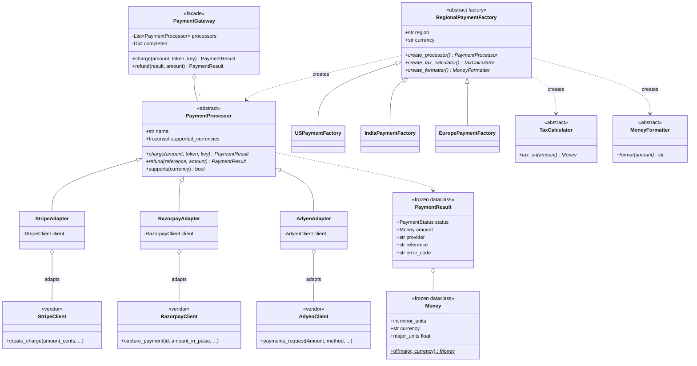

# Design a Payment Gateway

> **Difficulty:** 🔴 Hard · **Time:** ~70 min · **Patterns:** Adapter, Abstract Factory, Strategy, Facade

The Adapter problem in its natural habitat. Three payment providers, three
completely different APIs, none of which you can change — and one of the
mismatches between them will silently charge the wrong amount if you let it
through.

## The problem

Take payments through several providers. Your application code should not know
or care which one handled a given charge.

## Requirements

1. Support several providers with incompatible SDKs.
2. One interface for the application; no vendor types above the adapter layer.
3. Handle each provider's own way of reporting failure.
4. Region-specific currency, tax rules and formatting — kept consistent.
5. Retry a declined payment on another provider.
6. **The same idempotency key must never charge twice.**
7. Refunds go back through whoever took the money.

## Assumptions

- The vendor SDKs in `vendor/` are fakes standing in for real libraries. They
  are deliberately awkward, because that is the point.
- All charges settle synchronously. Webhooks are a follow-up.
- Money is integers in minor units, with the currency attached.

## What we are adapting

The three SDKs disagree about everything that matters:

| | Stripe | Razorpay | Adyen |
| --- | --- | --- | --- |
| Charge method | `create_charge` | `capture_payment` | `payments_request` |
| **Amount units** | **cents (int)** | **paise (int)** | **`Amount` object** |
| Failure | raises `StripeError` | returns `{"status": "failed"}` | raises `AdyenRefused` |
| Success | `"status": "succeeded"` | `"status": "captured"` | `"resultCode": "Authorised"` |
| Reference | `id` | `razorpay_payment_id` | `pspReference` |

The units row is the dangerous one. A bare integer sent to the wrong SDK does
not raise — it charges the wrong number.

## Class diagram



## How the design works

### Adapter, and the four mismatches it absorbs

Each adapter is thin, and does exactly four things:

1. **Renames the method** — `charge` becomes whatever that SDK calls it.
2. **Normalises failure.** Stripe raises, Razorpay returns a status field,
   Adyen raises its own type. All three become a `PaymentResult` with a status.
3. **Normalises the result shape** — `id` / `razorpay_payment_id` /
   `pspReference` all become `reference`.
4. **Converts units at the boundary.**

That fourth one is why this layer is not optional:

```python
self.client.create_charge(amount_cents=amount.minor_units, ...)
```

`Money` carries its currency, and each adapter converts on the way out. A bare
`int` crossing this boundary is a 100× error with no exception attached — the
most expensive kind of bug in the problem, and the only one that cannot be
caught by a type checker.

**Nothing above the adapter layer imports a vendor module.** That is the
property worth checking in a review, because it is what makes swapping a
provider a configuration change rather than a migration.

### A decline is not an error

```python
except StripeError as exc:
    return PaymentResult(status=_status_for(exc.code), ...)
```

A declined card is an ordinary business outcome. Letting a vendor exception
escape means every caller catches three different exception types and knows
which is which — which is the coupling the adapter was supposed to remove.

But the distinction between *kinds* of failure has to survive:

| | Meaning | Retry elsewhere? |
| --- | --- | --- |
| `DECLINED` | the bank said no | **yes** |
| `FAILED` | we sent a bad request | **no** |

Retrying a malformed request at three providers produces the same error three
times, more slowly, and looks like an outage in the metrics. The gateway stops
on `FAILED` and falls through on `DECLINED`, and there is a test for each.

### Abstract Factory, because the family must agree

A region needs three things: a processor that takes the local currency, the
local tax rules, and the local way of writing money.

```
India   ₹12,34,567.00   + GST 18%    (lakh grouping, Razorpay)
US      $1,234,567.00   + Sales Tax  (Stripe)
Europe  1.234.567,00 €  + VAT 20%    (Adyen)
```

Mixing them is not a style issue — a GST calculator with a US formatter
produces an invoice that is wrong twice over. Abstract Factory exists for
exactly this: families of related objects whose members must be consistent.

Three separate factories would let a caller assemble an inconsistent set. Here
there is no way to ask for one, and a parameterised test checks each region
produces a matched family.

This is also the honest distinction from Factory Method, which usually gets
muddled: Factory Method creates **one** product, Abstract Factory creates a
**family** of them that go together.

### Idempotency, at two levels

A client with a flaky connection retries. Charging twice is the worst outcome
in the whole system, so it is defended twice:

```python
if idempotency_key in self._completed:
    return self._completed[idempotency_key]  # no network call at all
```

and each SDK honours the key independently, in case our record is lost.

The demo retries four times and produces **one charge and one SDK call**.

One detail worth pointing out: a *declined* attempt is deliberately **not**
recorded as complete. Caching failures would mean a customer who fixes their
card cannot retry the same order.

### Refunds go back where the money went

The gateway may have fallen back to the second provider. Refunding through the
first would fail, or worse, succeed against an unrelated reference — so
`PaymentResult` carries its provider and the refund is routed by it.

## Running it

```bash
cd problems/payment-gateway && python3 src/main.py
```

```
3. Abstract Factory: the family members have to agree.

   United States       $1,234,567.00  + Sales Tax  =      $1,342,591.61
   India               ₹12,34,567.00  + GST        =      ₹14,56,789.06
   Europe             1.234.567,00 €  + VAT        =     1.481.480,40 €

4. A decline falls back. A bad request does not.

   declined card: tried ['stripe', 'adyen'] -> adyen: charged 25.00 USD (ADY0000000002)
   zero amount:   tried ['stripe'] -> stripe: failed — Amount must be positive

5. Idempotency: a flaky client retrying must not charge twice.

   attempt 1: ch_00000002
   attempt 4: ch_00000002
   1 charge created, 1 SDK call for 4 attempts
```

## Tests

```bash
python3 -m pytest problems/payment-gateway -v
```

## Follow-ups an interviewer will ask

- **A provider is down.** A circuit breaker, so you stop sending traffic at a
  failing provider instead of timing out on every request.
- **Asynchronous settlement.** Not every payment finishes in the request.
  Webhooks mean a fourth status — `PENDING` — and every caller has to handle it.
- **The gateway times out and you do not know the outcome.** The hardest case
  here. You need a reconciliation job that queries the provider by idempotency
  key, and the answer may take hours.
- **Route by cost.** Providers charge different rates per card type and
  country. That is a Strategy over the processor list, not a change to any
  adapter.
- **3-D Secure**, where the flow pauses for the customer to authenticate. The
  `charge` call stops being a single round trip.
- **Multi-currency settlement.** `Money` deliberately refuses to add two
  currencies; the moment you need that, you need a rate, a time it was taken,
  and somewhere to record the spread.
