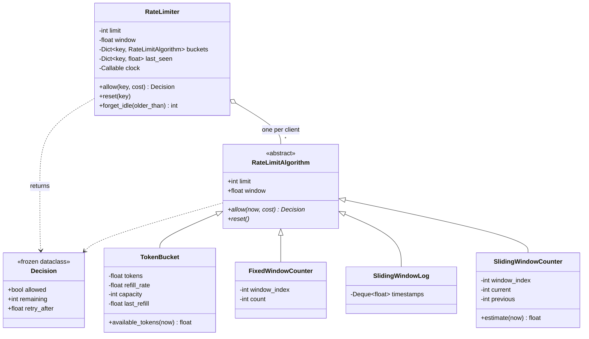

# Design a Rate Limiter

> **Difficulty:** 🟡 Medium · **Time:** ~50 min · **Patterns:** Strategy

Four algorithms that answer the same question and disagree about the answer.
The design work is small; the value is in knowing which one to reach for and
being able to say what each one gets wrong.

## The problem

Limit how many requests a client may make in a period of time. Reject the rest,
and tell the caller when to come back.

## Requirements

1. Allow at most N requests per client per window.
2. Each client has their own budget.
3. A rejection says how long to wait before retrying.
4. Support four algorithms — **token bucket**, **fixed window**, **sliding
   window log**, **sliding window counter** — behind one interface.
5. A rejected request must not consume budget or push the recovery time out.
6. A request may cost more than one unit.

## Assumptions

- Single process, in memory. Distributing it is the main follow-up.
- The client key is any hashable: a user id, an API key, an IP.
- The clock is monotonic and injected.

## Class diagram



## Choosing between them

| Algorithm | Memory per client | Bursts | Accuracy | Use when |
| --- | --- | --- | --- | --- |
| **Token bucket** | 2 floats | **Allowed on purpose** | Exact | Public APIs. Idle clients bank credit. |
| **Fixed window** | 2 ints | Boundary burst, up to 2× | Poor at edges | Cheap counting where a 2× overshoot is survivable. |
| **Sliding log** | O(limit) timestamps | None | Exact | Low limits where precision matters. |
| **Sliding counter** | 3 ints | Smoothed | ≈ exact, errs strict | The usual production default. |

Run `python3 src/main.py` and the difference is one line of output:

```
Traffic: 5 requests at t=9.9s, then 5 more at t=10.1s. Limit is 5 per 10s.

  token-bucket             .....xxxxx   5/10 allowed
  fixed-window             ..........   10/10 allowed
  sliding-window-log       .....xxxxx   5/10 allowed
  sliding-window-counter   .....xxxxx   5/10 allowed
```

That 10/10 is the **boundary burst**, and it is the single most useful thing to
be able to name in this interview.

## How the design works

### Strategy, because the difference is a trade, not a hierarchy

All four algorithms answer one question — may this request through right now? —
and differ only in how they remember the recent past. That difference is
entirely a memory-versus-accuracy trade. It belongs behind one interface, not
in four kinds of limiter.

### `now` is a parameter, not a clock read

Every one of these is a time-based algorithm, and a time-based algorithm that
reads its own clock can only be tested by sleeping. Passing `now` in means the
whole suite runs in milliseconds and every assertion about refill rates and
window boundaries is exact.

### Token bucket computes lazily

Nothing is scheduled and no timer runs. Tokens are derived from elapsed time on
each call:

```python
self._tokens = min(self.capacity, self._tokens + elapsed * self.refill_rate)
```

An idle client therefore costs nothing to maintain, which is what makes this
viable at a million clients. It also means a backwards clock must be handled
explicitly — otherwise a negative `elapsed` mints tokens out of nothing.

`capacity` is separate from `limit` so burst size and sustained rate can be set
independently: 60 per minute sustained, never more than 5 back to back.

### Sliding window counter, in one line

```python
estimate = previous_count * (1 - elapsed_fraction) + current_count
```

Thirty seconds into a sixty-second window, half of the previous window still
counts. That kills the boundary burst without storing a timestamp per request.

It is an approximation and it **errs strict**: it assumes the previous window's
requests were spread evenly, so a client who bunched them all at the start gets
rejected slightly early. For a rate limiter, early is the safe direction to be
wrong in — and there is a test that pins that behaviour down rather than
letting it look like a bug.

### The bucket map is a memory leak unless you say otherwise

Buckets are created lazily per client, which is right. But without eviction,
every key ever seen keeps a bucket forever.

`forget_idle` handles it, and refuses an interval shorter than one window —
dropping a bucket resets that client's budget, so forgetting too eagerly lets a
client clear their own limit by pausing briefly. In production this job usually
goes to a TTL on the backing store, but the constraint is the same wherever it
lives.

## Running it

```bash
cd problems/rate-limiter && python3 src/main.py
```

## Tests

```bash
python3 -m pytest problems/rate-limiter -v
```

The shared behaviours are parameterised across all four algorithms, so a new
algorithm inherits the whole contract by being added to one list. The
differences then get their own named tests — including one that asserts the
fixed window *does* allow the boundary burst, so the fix can be shown to fix it.

## Follow-ups an interviewer will ask

- **Distribute it across servers.** The counter moves to Redis, and the
  read-modify-write becomes a race — a Lua script or `INCR` with an expiry.
  Token bucket distributes worst because it is the most stateful.
- **Different limits per tier.** Free 100/hour, paid 10,000/hour. Does the
  limiter look the limit up, or does the caller pass it in?
- **Limit by several keys at once** — per user *and* per IP *and* per endpoint.
  All must pass; which rejection do you report?
- **What happens when the limiter itself is down?** Fail open or fail closed?
  For billing, closed. For a login page, probably open.
- **Why not a leaky bucket?** It shapes traffic to a constant output rate
  rather than gating admission — a queue, not a limiter.
- **Return standard headers.** `X-RateLimit-Remaining` and `Retry-After` are
  already on `Decision`.
