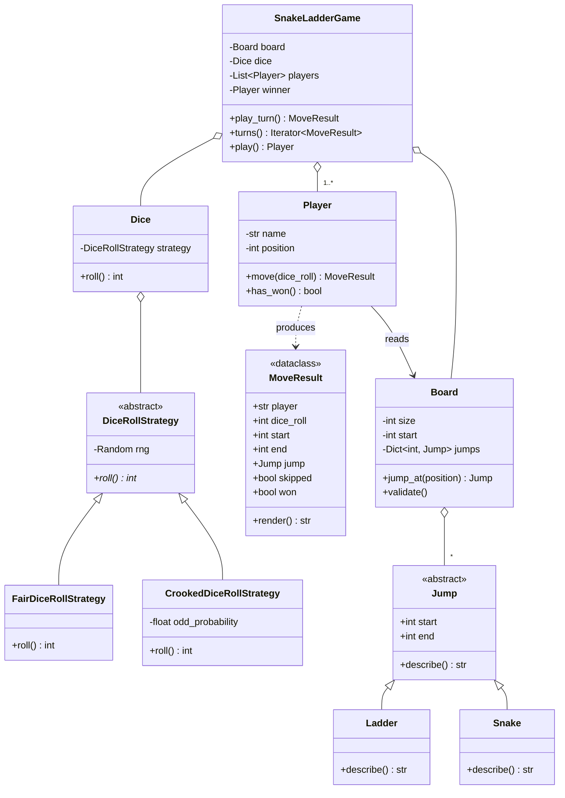

# Snake and Ladder

> **Difficulty:** 🟢 Easy · **Time:** ~45 min · **Patterns:** Strategy

A small problem with a sharp edge. The turn loop is trivial; what an interviewer
is actually watching is whether you can swap the die out without touching the
game, and whether you notice the board rules that quietly break things.

## The problem

Build a game of Snake and Ladder for two or more players. Players take turns
rolling a die and moving up the board. Land on the foot of a ladder and you
climb it; land on the head of a snake and you slide down. First player to land
exactly on the final square wins.

## Requirements

1. The board runs from square 0 to square 100.
2. The game can be played with a **fair** die or a **crooked** one that favours
   even numbers, and picking between them must not mean editing the game loop.
3. The number of players is decided at the start of the game.
4. Snakes and ladders are placed on the board at setup.
5. No snake or ladder may end on the square another one starts from, so a
   single roll can never trigger a chain of jumps.

## Assumptions

- One die per turn.
- A roll that would take you past the final square does not move you at all.
- You must land **exactly** on the final square to win.
- Players move in a fixed order, and no square is exclusive — two players can
  share one.

## Class diagram



## How the design works

**Strategy, for the die.** `Dice` holds a `DiceRollStrategy` and forwards every
roll to it. It never learns which kind of die it is holding. Adding a loaded
die, or one that sums two dice, is a new class and one dictionary entry — no
branch anywhere else grows.

The giveaway that this is real Strategy and not an `if` in disguise: the
strategy is chosen **once**, at construction. A `roll()` that re-checks a
`strategy` string on every call is a switch statement wearing a costume.

**A seedable random source.** Every strategy takes an optional
`random.Random`. That single parameter is what makes a dice game testable and
a demo replayable — `--seed 7` gives you the same game every time.

**Snakes and ladders are one type.** They differ only in direction and wording,
so they share a `Jump` base class. Each subclass validates its own direction:
a `Ladder` that goes down and a `Snake` that goes up are both construction
errors, caught the moment you build the board rather than mid-game.

**The board validates itself.** `Board.validate()` rejects layouts where one
jump lands on the start of another. This is the requirement people skip, and
skipping it means a single roll can cascade through several jumps.

**Turns are values, not print statements.** `Player.move()` returns a
`MoveResult` describing what happened. The game loop renders it; tests assert
on it. A design that prints from inside the model can only be verified by
capturing stdout, which is why the original version of this code was untestable.

## Running it

```bash
cd problems/snake-and-ladder && python3 src/main.py
```

Or skip the prompts:

```bash
cd problems/snake-and-ladder && python3 src/main.py --players Alice Bob --dice crooked --seed 7
```

```
Alice rolled 2
Alice is now on square 2

Bob rolled 2
(climbs a ladder from 9 to 31)
Bob is now on square 31
...
Bob is now on square 100
Bob has won the game!

Final positions: Alice=91, Bob=100
```

## Tests

```bash
python3 -m pytest problems/snake-and-ladder -v
```

The tests use a `ScriptedDice` that rolls whatever the test tells it to, which
is how a game of chance gets deterministic test cases.

## Follow-ups an interviewer will ask

- **Rolling a 6 earns another turn.** Where does that live — `Player`, the game
  loop, or the die? (The die decides the number; the game decides whose turn it
  is, so it belongs in the loop.)
- **Place snakes and ladders randomly at setup.** You now need generation that
  satisfies `validate()` rather than a hand-checked constant.
- **Multiple dice.** A `MultiDiceStrategy` wrapping N strategies drops in
  without the game noticing.
- **Undo the last move.** Memento, or replay from a stored list of
  `MoveResult`s — you already have the log.
- **Persist a game in progress.** What is the minimum state you need to resume?
