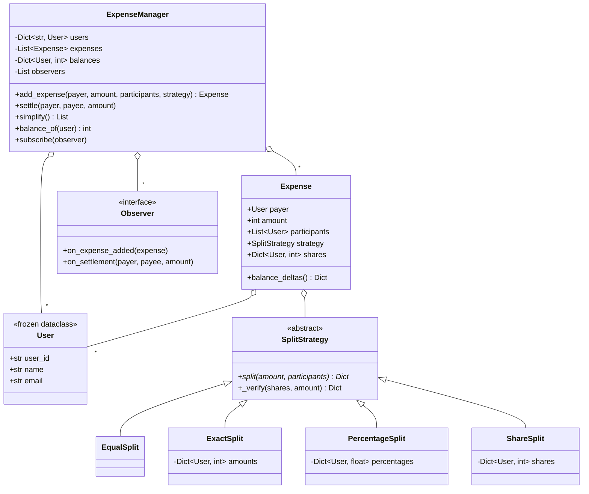

# Design Splitwise

> **Difficulty:** 🟡 Medium · **Time:** ~60 min · **Patterns:** Strategy, Observer

The design is straightforward and most candidates get it. What separates
answers is arithmetic: what happens to the leftover cent when 100 is split
three ways, and how many payments it takes to settle a group.

## The problem

Track shared expenses in a group. Anyone can pay for anything, split it however
they like, and at any point the group should be able to see who owes whom — and
settle up in as few payments as possible.

## Requirements

1. Four ways to split an expense:
   - **Equal** — everyone pays the same
   - **Exact** — each share stated outright
   - **Percentage** — shares as percentages, totalling 100
   - **Share** — weights, e.g. 2 shares to one person and 1 each to two others
2. Shares must sum **exactly** to the expense. No cent lost, none invented.
3. Show the net position of every person.
4. Produce a minimal set of payments that settles everyone.
5. Notify interested parties when an expense or settlement is recorded.

## Assumptions

- All amounts are integers in the smallest currency unit. There is no float
  money anywhere in this design.
- One currency.
- The payer need not be one of the participants — covering a bill you had no
  part in is legitimate.

## Class diagram



## How the design works

### Integer money, and the leftover cent

Every amount is an integer in the smallest unit. Floats in money code are a bug
waiting for a rounding boundary — `0.1 + 0.2 != 0.3` — and the failure is
delayed and cumulative: it surfaces months later as a one-cent discrepancy
nobody can explain.

Integers alone are not enough, though. Split 100 three ways:

- 33 each loses a cent
- 34 each invents one

Both are wrong, and both are what a naive implementation does. The fix is the
**largest remainder method**: floor every share, then hand the leftover units
to whoever was rounded down hardest.

```python
base, remainder = divmod(amount, count)
shares = {user: base + (1 if i < remainder else 0) for i, user in enumerate(participants)}
```

100 across three people becomes **34, 33, 33** — exact, and nobody is more than
one cent out of step with anyone else.

Every strategy ends with the same assertion:

```python
def _verify(shares, amount):
    if sum(shares.values()) != amount:
        raise ValueError(...)
```

That single invariant is what makes every balance downstream trustworthy. The
test suite checks it for every amount from 1 to 200, because off-by-one
remainder bugs hide in exactly the cases nobody writes a test for by hand.

### Net balances, not a debt matrix

The obvious model is a matrix of who-owes-whom. It is worse than it looks: if
Alice owes Bob 10 and Bob owes Carol 10, the matrix records two debts where the
group really has one, and settlement means untangling chains.

One net figure per person collapses all of that on the way in. Alice at −10 and
Carol at +10 is the whole story, and it settles in one payment.

A useful property falls out for free: **balances always sum to zero**. Any
expense credits the payer exactly what it debits the participants. If that sum
drifts from zero, something is wrong — and there is a test asserting it.

### Settling up, and what greedy does not promise

`simplify()` repeatedly matches the largest debtor against the largest
creditor. Each round zeroes at least one person, so it never needs more than
`n−1` payments for `n` people, and usually far fewer.

It is **not** guaranteed to be the theoretical minimum. Finding that is
equivalent to a subset-sum problem and is NP-hard. Claiming optimality the
algorithm does not have is a much worse answer than saying "greedy, `n−1`
bound, the true minimum is NP-hard, and this is what production apps ship
because it is close enough and it terminates."

### Shares are frozen when the expense is created

`Expense` computes its shares in `__post_init__` and stores them. Recomputing
on every read would let a strategy object mutated later silently rewrite
history — and a ledger whose past changes is not a ledger. There is a test that
mutates a strategy after the fact and asserts the recorded expense does not
move.

### Observer, for everything downstream

The manager announces expenses and settlements without knowing who is
listening. Push notifications, an audit log, a running "you owe Bob" badge —
each subscribes rather than being wired into `add_expense`.

## Running it

```bash
cd problems/splitwise && python3 src/main.py
```

A weekend trip for four, using all four split types:

```
Groceries: Alice paid 100.01
  split equal
    Alice        25.01      <- the leftover cent
    Bob          25.00
    Carol        25.00
    Dave         25.00

Net balances (positive = the group owes them):
  Alice       -139.50
  Bob          231.50
  Carol        -79.00
  Dave         -13.00

3 payments settle all four people:
  Alice pays Bob 139.50
  Carol pays Bob 79.00
  Dave pays Bob 13.00

After settling: Everyone is settled up.
```

## Tests

```bash
python3 -m pytest problems/splitwise -v
```

## Follow-ups an interviewer will ask

- **Multiple currencies.** Does the expense store its own currency and a rate?
  What rate — at the time of the expense, or at settlement? (The first; the
  second means balances move on their own.)
- **Groups.** A user in several groups: are balances per group, or global?
- **Editing or deleting a past expense.** Reverse and re-apply, or recompute
  from the whole log? The second is slower and much easier to get right.
- **Rotate who absorbs the remainder** so the same person is not always paying
  the extra cent. Where does that state live?
- **Simplify only within a group** — people often do not want a stranger's name
  appearing in their settlement plan.
- **Concurrent expenses.** Two people adding at once is a read-modify-write on
  the same balances.
