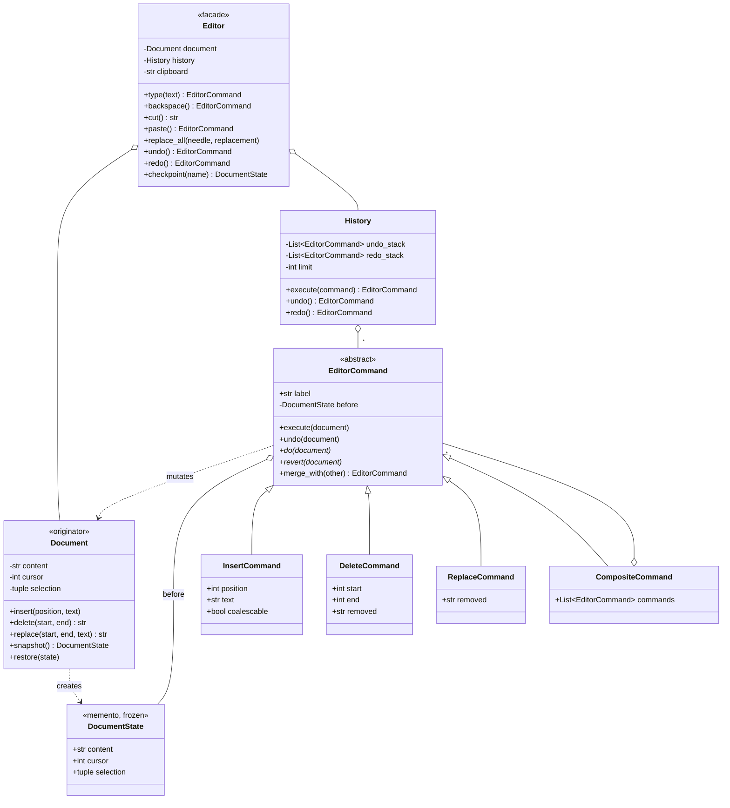

# Design a Text Editor with Undo

> **Difficulty:** 🟡 Medium · **Time:** ~55 min · **Patterns:** Command, Memento, Composite, Facade

Undo looks like a stack until you build one. Then it turns out the interesting
questions are all about what a *user* thinks one action is — and about the one
rule that, missed, corrupts the document silently.

## The problem

Build a text editor with undo and redo, a clipboard, and find-and-replace.

## Requirements

1. Insert, delete and replace text.
2. Undo and redo, to arbitrary depth.
3. Cursor and selection; typing over a selection replaces it.
4. Cut, copy, paste.
5. Find, and replace-all.
6. Undo must match what a user considers **one action**.
7. The undo history must not grow without bound.

## Assumptions

- Single document, single cursor.
- Content is one Python string. A real editor needs a rope or piece table —
  see the follow-ups.
- Single-threaded; no collaborative editing.

## Class diagram



## How the design works

### Command or Memento? Both, for different jobs

There are two ways to build undo, and the difference is memory:

| | How undo works | Cost per edit |
| --- | --- | --- |
| **Memento** | snapshot the whole document, restore it | size of the **document** |
| **Command** | store just enough to invert this edit | size of the **edit** |

Memento is simpler and always correct. It is also unusable: every keystroke in
a 10 MB file costs 10 MB. Command is what real editors do — typing one
character remembers one character.

So Command is the primary mechanism here. But Memento still earns its place in
two spots where it is genuinely better:

- **Cursor and selection.** Tiny, and awkward to reconstruct from an inverse
  operation. Every command snapshots them and restores them wholesale.
- **Checkpoints.** A named "put it back how it was", where exactness matters
  more than memory.

"Command, with a memento for the parts that are cheap to snapshot and painful
to reverse" is a better answer than either pattern alone.

### The rule that corrupts documents

```python
def execute(self, command):
    command.execute(self.document)
    self._redo_stack.clear()  # ← this line
```

Undo three times, then type something. Those three redos are **gone**. The
document has branched; the future you were about to redo into no longer exists.

Leave them in place and a redo replays an edit computed against text that is no
longer there — an insert at offset 40 in a document that is now 12 characters
long. It does not raise. It quietly writes the wrong thing in the wrong place,
and the user finds out much later.

There is a test for this specifically, and a second one that undoes back past
the branch point to confirm the stack is still coherent afterwards.

### Undo should match what a user did, not what the code did

Typing "hello" is five `InsertCommand`s. Pressing undo once should remove all
five — nobody expects to press it per character.

`merge_with` coalesces consecutive inserts, and stops at the boundaries a user
would expect:

- a **newline** ends the run — a line break is a natural undo boundary
- **80 characters** ends the run — one undo should not wipe out a paragraph
- a **cursor move** ends the run — the next text is somewhere else

The detail worth getting right: only **keystrokes** coalesce.

```python
InsertCommand(position, text, coalescable=True)  # from type()
InsertCommand(position, text)  # from insert()
```

The first version merged anything adjacent, which quietly folded two
deliberate, programmatic `insert()` calls into one undo step. Adjacency is not
intent — so intent is now stated explicitly, and the tests cover both.

### Composite, for edits the user thinks of as one

Replace-all across twelve matches is twelve `ReplaceCommand`s and **one** undo
step. `CompositeCommand` holds them and reverses in the opposite order, which is
not optional: each edit shifts the offsets the later ones were computed against.

Replace-all also applies its matches **right to left**, for the same reason
going the other way needs every subsequent offset adjusted by the length delta.

### Inverse data is captured when the command runs

```python
class DeleteCommand:
    def do(self, document):
        self.removed = document.delete(self.start, self.end)  # not in __init__
```

At construction the document may not yet be in the state this command expects —
redoing a stack replays commands in order, and each one sees the document as
the previous one left it. Reading it in `__init__` captures the wrong text.

### Moving the caret clears the selection

This one only surfaced when the demo pasted in the wrong place. `move_cursor`
left the selection alive, so the next `type()` replaced text nowhere near where
the caret now was.

Clicking elsewhere deselects, in every editor ever written. The fix is one line
in `Document.move_cursor`, and it is the kind of thing that is obvious in
hindsight and invisible until something exercises the path.

### Bounded history

An unbounded undo stack is an unbounded leak in a long editing session.
`History` drops the oldest entries past its limit, because nobody undoes four
thousand steps — and the test asserts it is the *oldest* that go, not the
newest.

## Running it

```bash
cd problems/text-editor && python3 src/main.py
```

```
1. Typing character by character coalesces into ONE undo step.

  'hello|'                                   [undo:1]  five keystrokes
  '|'                                        [undo:0 redo:1+]  one undo took all five
  'hello|'                                   [undo:1]  and one redo brought them back

3. The rule everyone gets wrong: a new edit clears the redo stack.

  'hello\n|'                                 [undo:2 redo:1+]  can_redo=True
  'hello\nthere|'                            [undo:3]  typed something -> can_redo=False

4. Replace-all is one undo step, not one per match.

  'the cOG| sOG on the mOG'                  [undo:1]  Undo Replace 3 occurrences
  'the cat sat on the mat|'                  [undo:0 redo:1+]  all three reversed together
```

Or drive it with `--interactive`.

## Tests

```bash
python3 -m pytest problems/text-editor -v
```

## Follow-ups an interviewer will ask

- **A 500 MB file.** One Python string means every insert copies the whole
  document. A **rope** or **piece table** fixes it — and a piece table is
  especially neat here, because it makes undo nearly free.
- **Multiple cursors.** Every command becomes a composite, and the offset
  arithmetic between them is the hard part.
- **Collaborative editing.** Commands are a decent starting point, but two
  people editing concurrently needs operational transforms or CRDTs — undo in
  a shared document means *my* last edit, not the document's.
- **An undo tree instead of a stack.** Do not discard the redo branch; keep it
  and let the user navigate between branches. Emacs and Vim both do this.
- **Persist the history** across sessions. Which commands serialise cleanly,
  and what happens to the file underneath in between?
- **Syntax highlighting.** A decorator over the document, or a separate view
  layer that subscribes to changes?
