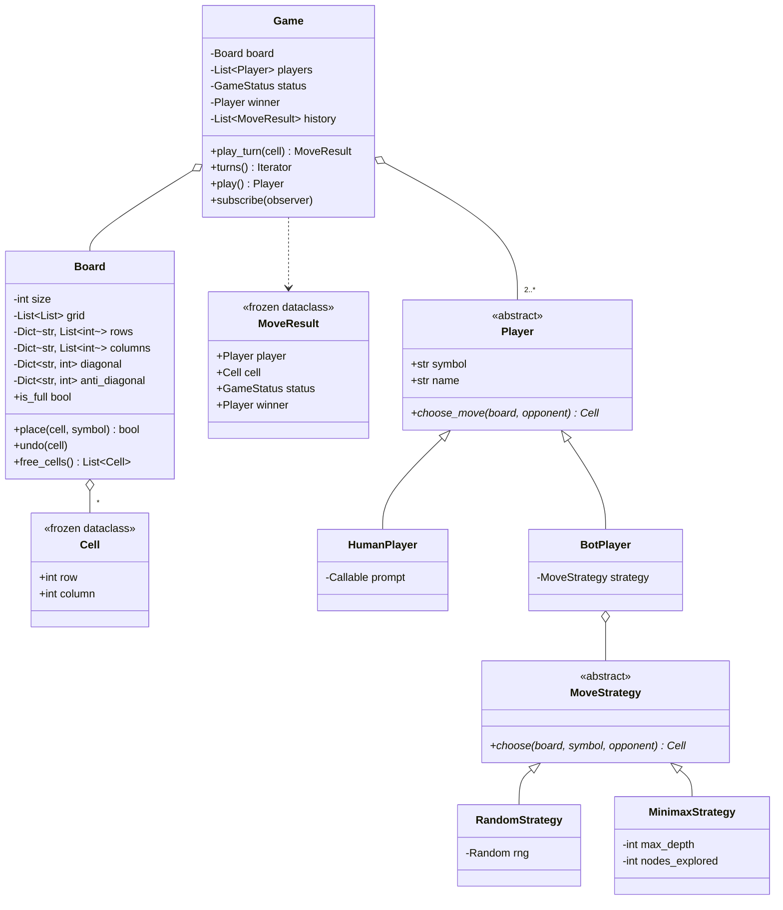

# Design Tic Tac Toe

> **Difficulty:** 🟢 Easy · **Time:** ~40 min · **Patterns:** Strategy, Observer

Easy to finish, easy to finish badly. Two things separate a good answer: a win
check that does not scan the board, and a bot whose difficulty is a strategy
rather than a flag.

## The problem

Build Tic Tac Toe for two players on an N×N board, where a player can be a
human or a bot, and the bot's difficulty can be changed without touching the
game.

## Requirements

1. An N×N board, defaulting to 3×3.
2. Players alternate; a player wins with a full row, column or diagonal.
3. A full board with no line is a draw.
4. Reject moves off the board or onto a taken square.
5. Support human and bot players interchangeably.
6. The bot's difficulty is swappable.
7. Notify observers of each move.

## Assumptions

- Two players, one symbol each. More players is a follow-up.
- A win needs a full line of N, not k-in-a-row.
- Single-threaded, one game at a time.

## Class diagram



## How the design works

### Win detection without scanning

The obvious check walks the row, the column and both diagonals after every
move. That is O(n) per move, and the diagonal conditions are easy to get subtly
wrong.

Instead, each symbol keeps a running count per row, per column, and one for
each diagonal. Placing a symbol bumps **at most four counters**, and a win is
any counter reaching `n`:

```python
rows[cell.row] += delta
columns[cell.column] += delta
if cell.row == cell.column:
    diagonal[symbol] += delta
if cell.row + cell.column == size - 1:
    anti_diagonal[symbol] += delta
```

O(1) per move, and the same code runs on 3×3 and 19×19 — which is why "now make
it N×N" is a non-event here rather than a rewrite. The tests check win detection
at sizes 3, 4, 5 and 8 without any size-specific code.

### Undo has to undo the counters too

`_bump` takes a `delta` of `+1` or `-1` precisely so `undo` is the same code
path in reverse. Getting this wrong is a genuinely nasty bug: an undo that
clears the grid but leaves the counters makes minimax see wins that are not
there, and the bot plays nonsense for reasons that are invisible in the
rendered board. There is a test for exactly that.

### Two kinds of Strategy, deliberately kept apart

- **`Player`** is *who* is moving — a human reading a prompt, or a bot.
- **`MoveStrategy`** is *how* a bot decides — random, minimax, anything else.

Folding them together needs a class per (player kind × difficulty). Apart,
adding a "medium" bot is one strategy class and nothing else changes.

### Minimax, and two details people miss

**Depth belongs in the score.** `score = 10 - depth` makes the bot prefer a win
in two moves over a win in four, and a loss in four over a loss in two. Without
it, a bot that has already concluded it will lose plays as though nothing
matters — technically optimal, and it looks broken to anyone watching.

**Alpha-beta pruning** is what makes the search viable. A full 8-ply tree is
8! = 40,320 leaves; pruning cuts it by well over an order of magnitude, and a
test pins that down so a regression in the pruning shows up as a failure rather
than as a slow demo.

`max_depth` still exists, because on a 4×4 board the tree is 16! nodes and no
amount of pruning saves you.

### Testing the human player

`HumanPlayer` takes a `prompt` callable instead of calling `input()` directly.
The same class then works at a terminal, in a test, and behind an HTTP handler —
and the retry-on-bad-input loop is actually covered.

## Running it

```bash
cd problems/tic-tac-toe && python3 src/main.py
```

Play against the perfect bot:

```bash
cd problems/tic-tac-toe && python3 src/main.py --human
```

Two perfect players, which can only ever draw:

```bash
cd problems/tic-tac-toe && python3 src/main.py --x perfect --o perfect
```

## Tests

```bash
python3 -m pytest problems/tic-tac-toe -v
```

Two of them are worth pointing at: perfect versus perfect must always draw
(the game is a solved draw), and perfect versus random must never lose across
eight different seeds. Those assert the bot's actual guarantee rather than that
it merely returns a legal move.

## Follow-ups an interviewer will ask

- **k-in-a-row on an N×N board** (Gomoku). The counter trick stops working —
  a line of 5 can start anywhere. What replaces it?
- **More than two players.** What does that do to minimax? (It stops being
  minimax; you need maxⁿ.)
- **Undo and redo.** The board already supports undo for minimax; what does the
  *game* need on top — a move stack, or Memento?
- **A bot that makes deliberate mistakes**, so it is beatable. A strategy that
  plays optimally with probability p.
- **Persist a game in progress.** What is the minimum state — the grid, or the
  move list?
