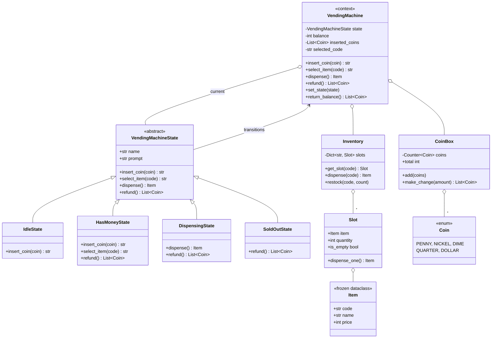
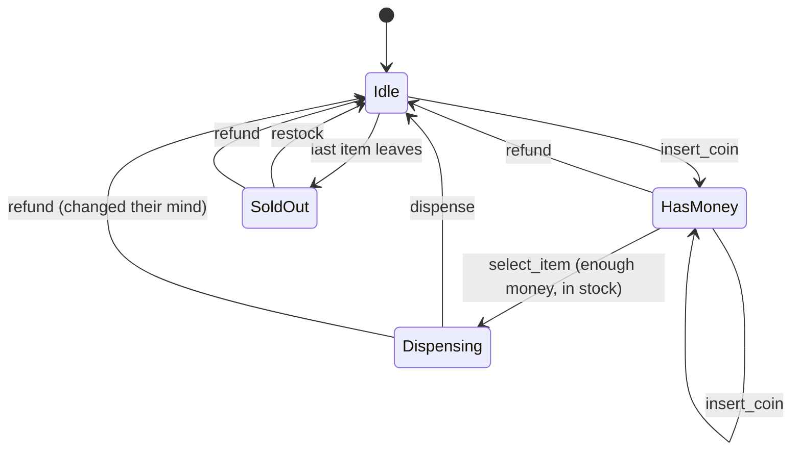

# Design a Vending Machine

> **Difficulty:** 🟡 Medium · **Time:** ~50 min · **Patterns:** State

The canonical State pattern problem. Everyone gets the happy path. What
separates answers is the handling of the cases where the machine has to refuse
— and whether the refusals leave the buyer's money somewhere sensible.

## The problem

Build a vending machine that takes coins, lets a buyer select an item, dispenses
it, and returns the correct change. It must behave sensibly when asked to do
something it cannot do right now.

## Requirements

1. Accept a fixed set of coin denominations.
2. Let a buyer select an item once enough money is in.
3. Dispense the item and return the exact change.
4. Refund on request, at any point before the item drops.
5. Refuse actions that make no sense in the current state, with a message that
   says what the machine *is* waiting for.
6. Report when an item — or the whole machine — is sold out.
7. An operator can restock items and load the change float.

## Assumptions

- All amounts are integers in the smallest currency unit (cents), so there is
  no floating-point money anywhere.
- One item per transaction.
- Inserted coins are held in escrow until the sale completes, which is how a
  refund can always return the exact coins that went in.
- Single-threaded: one buyer at a time.

## Class diagram



### The state machine



## How the design works

**Behaviour lives in the state object, not in a flag.** Each state implements
the same four actions, and what differs is which ones it accepts. The base
class refuses everything by default with a message naming what the machine is
waiting for; each state overrides only what it supports.

That default-refuse base is what keeps the states short. `SoldOutState` is
eight lines because "refuse everything except a refund" needed no code.

The alternative is `if self.status == "idle": ...` at the top of every method.
It works, right up until you add a card-payment state or a maintenance state
and have to revisit every method hoping you found them all. Here, a new state
is a new class and nothing existing changes.

**One state instance each, created once.** States hold no per-transaction
data — balance, inserted coins and the current selection all live on the
machine — so they are safe to reuse for the life of the machine.

### Ordering is the whole answer

The interesting case is a machine that cannot make change. Look at the order
inside `DispensingState.dispense`:

```python
change = machine.coin_box.make_change(machine.balance - price)   # may raise
item = machine.inventory.dispense(code)                          # only after
```

Change comes out of the box **before** the item leaves the shelf. `make_change`
does its work on a copy of the coin counts and only commits if it can pay in
full, so a failure leaves the machine byte-for-byte as it was: item still on
the shelf, buyer's money still theirs, state unchanged.

Do it the other way round and the machine hands over goods it cannot settle for.
The tests assert both halves of that, because "it raised an exception" is not
the same as "it left nothing broken behind".

### Refunds return coins, not value

`return_balance` hands back the exact coin objects that were inserted, rather
than asking the coin box to make that amount. If it went through the float, a
machine low on change could refuse to refund a buyer who had done nothing
wrong. Real machines hold inserted coins in escrow for exactly this reason.

### Greedy change-making

`CoinBox.make_change` takes the largest coin that fits, repeatedly. That is
correct for any *canonical* denomination system, which 1/5/10/25/100 is.

It is worth saying out loud that greedy is not universally correct: with coins
of 1, 3 and 4, greedy makes 6 as 4+1+1 when 3+3 is better. Naming that limit
unprompted is usually worth more than the code.

## Running it

```bash
cd problems/vending-machine && python3 src/main.py
```

```
> insert dollar
Accepted dollar. Balance: 100.

> select A1
Selected Coke at 75.

> dispense
Dispensed Coke. Change: quarter

> select A1
  Cannot select an item right now. Insert a coin to begin.
```

Or drive it yourself with `--interactive`.

## Tests

```bash
python3 -m pytest problems/vending-machine -v
```

## Follow-ups an interviewer will ask

- **Card payment.** A new state, or a payment strategy the states share?
  (Strategy — the transitions do not change, only how money arrives.)
- **The machine cannot make change. What should it do *before* taking the
  money?** Refusing at insert time needs lookahead the machine does not have
  yet; showing "exact change only" is the real-world answer.
- **Two buyers at once.** Where is the race, and is a lock on the machine or on
  the slot the right granularity?
- **A purchase history.** Observer, with the state transitions as the events.
- **Time-limited sessions** — money returned after 30 seconds of inactivity.
  Which state owns the timer?
